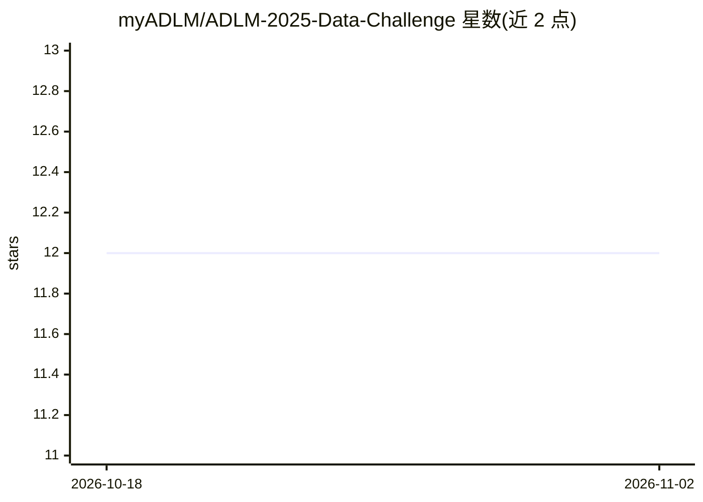

# myADLM/ADLM-2025-Data-Challenge

⭐ 12 · 推送 2026-09-22 · [GitHub](https://github.com/myADLM/ADLM-2025-Data-Challenge) · 组织维护

**ADLM 2025 数据科学竞赛：为实验室文档构建 AI 信息提取工具**

美国检验医学协会（ADLM）主办的 2025 年数据科学挑战赛仓库：参赛者基于其提供的约 3.5GB 合成实验室文档数据集（Zenodo 下载），开发从文档库中提取并呈现用户所需信息的 AI 工具。预赛按准确性、用户体验、可解释性（需给出文档出处引用）与工程最佳实践四项各 10 分评分；前两名进入线上决赛。仓库同时公告 Team Indigo 获胜，并给出 fork、克隆、提交 PR 的参赛流程。数据集由 LLM 生成，仅供教育用途，禁止临床使用。

## 筛选速览

| 维度 | 判定 | 备注 |
|---|---|---|
| AI 角色 | `ai-knowledge` | 知识聚合/清单类 |
| 许可风险 | `none` | — |
| 部署形态 | `desktop` | 安装包/桌面程序 |
| 模型依赖 | — | README 未给出锁定关系 |
| 硬件要求 | — | 无带数字的原话,不猜 |
| 安装摩擦 | `low` | 无编译、无系统依赖或容器化 |
| 成熟度 | — | 结构信号不足 |

## 能力要点

- 提供约 3.5GB 合成实验室文档数据集（Zenodo 托管）
- 评分含准确性、用户体验、可解释性与工程最佳实践四维度
- 决赛以现场问答形式比拼回答速度与准确性

## 适用场景

- 参加或复盘 ADLM 2025 数据科学挑战赛
- 获取实验室文档问答任务的基准数据集
- 了解 LLM 文档信息提取类竞赛的评分与流程设计

## 场景标签

`文档问答` · 领域:知识与检索

## 证据(README 行号)

> L31: We want you to develop an AI tool to make looking up information in laboratory documentation faster and more effici

## 星数曲线

2026-10-18 12 → 2026-11-02 12（+0）

---
*卡片 v1 · prompt 1.4 · 生成 2026-11-01 · 置信度 high · 依据 README sha `0f5c0b63aa90` · [字段定义](../../DATASET.md)*
