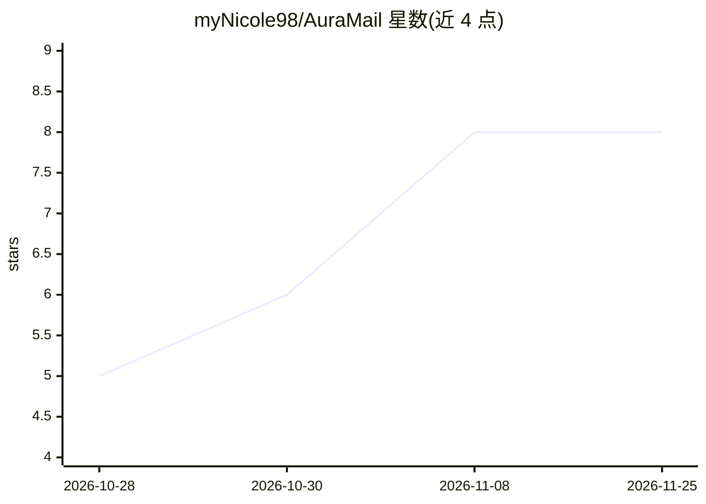

# myNicole98/AuraMail

⭐ 8 · Rust · MIT · 推送 2026-11-18 · [GitHub](https://github.com/myNicole98/AuraMail) · [官网](https://git.nikkosphere.com/nicole/AuraMail) · 个人维护

**面向个人用户的跨平台邮件客户端，含可选 AI 助手**

基于 Tauri/Svelte 构建的跨平台邮件客户端，支持 IMAP/SMTP 账户、Google 与 Microsoft OAuth、CalDAV/CardDAV 日历与联系人、分类标签与规则、以及沙盒化的 Spaces 多配置环境。内置 Proton Mail 原生集成，无需付费账户或外部桥接。AI 部分为可选的 AuraAI，通过本地或 OpenAI 云端运行，提供邮件分类、上下文感知回复起草与写作辅助。项目由单人开发，作者声明尚不适合生产使用。

## 筛选速览

| 维度 | 判定 | 备注 |
|---|---|---|
| AI 角色 | `ai-enhanced` | 去掉 AI 部分产品仍成立 |
| 许可风险 | `permissive` | MIT |
| 部署形态 | `None` |  |
| 模型依赖 | — | README 未给出锁定关系 |
| 硬件要求 | — | 无带数字的原话,不猜 |
| 安装摩擦 | `low` | 无编译、无系统依赖或容器化 |
| 成熟度 | `idea` | |

## 能力要点

- IMAP/SMTP 与 Google/Microsoft OAuth 登录（Google/Microsoft 验证仍存在阻碍）
- Proton Mail 原生集成，无需付费账户或外部桥接
- CalDAV/CardDAV 日历与联系人支持
- 可选 AuraAI：邮件分类、回复起草与写作辅助

## 适用场景

- 在桌面端统一管理多个 IMAP/OAuth 邮箱账户
- 无桥接直接使用 Proton Mail
- 用可选 AI 助手分类邮件并起草回复
- 按个人/工作划分 Spaces 并分别配置主题与通知

## 场景标签

`AI 助手` `AI 写作` · 领域:对话与助手

## 证据(README 行号)

> L5: AuraMail is a cross platform email client built to be fast, modern, customizable and with powerful but unintrusive A
> L46: AuraAI is an optional companion ran through a local or an OpenAI cloud provider that can assist you in a variety of

## 星数曲线

2026-10-28 5 → 2026-11-25 8（+3）

---
*卡片 v1 · prompt 1.4 · 生成 2026-11-20 · 置信度 high · 依据 README sha `2dea9f55a1b1` · [字段定义](../../DATASET.md)*
