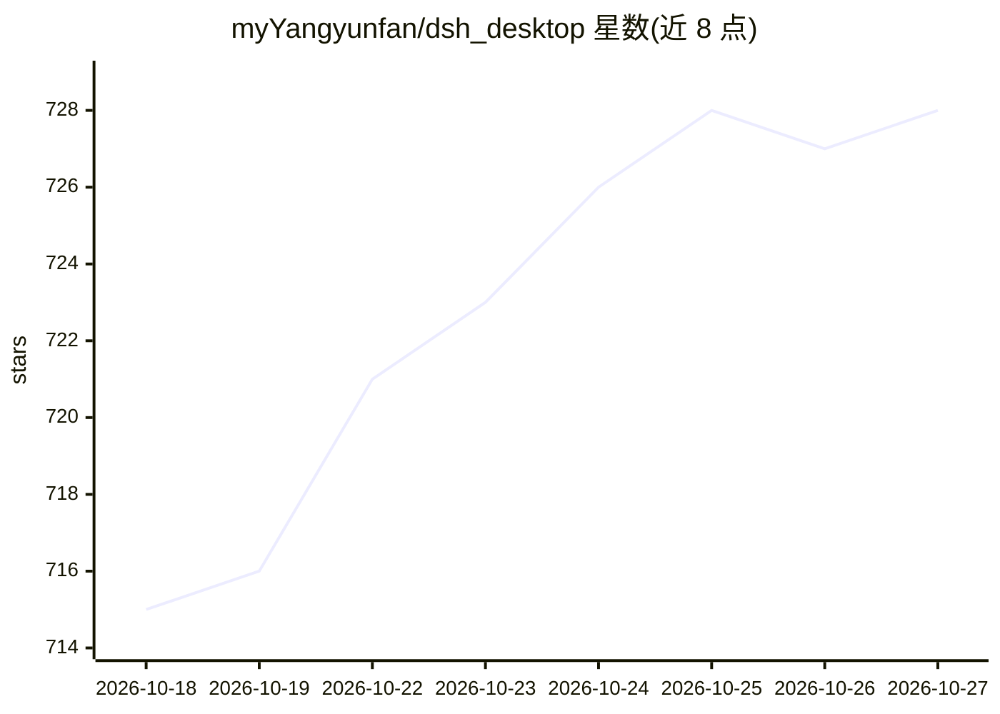

# myYangyunfan/dsh_desktop

⭐ 728 · JavaScript · MIT · 推送 2026-10-22 · [GitHub](https://github.com/myYangyunfan/dsh_desktop) · [官网](https://github.com/myYangyunfan/dsh_desktop/releases) · 个人维护 · 中文 README

**把 DeepSeek Harness 装进桌面的开箱即用客户端**

基于 Tauri 2（Rust）的桌面壳应用，打包 @deepseek-ai/dsh 运行时与官方插件，内置独立 Node 运行时与 npm CLI，目标机器无需预装环境，双击启动 dsh web 并载入原生窗口。提供会话归档/恢复/删除、余额小部件、侧边会话浮窗、完成通知；boot 链逐级自愈（坏插件/坏配置自动修复、内核崩溃原地重启）与双源自动更新（GitHub/Gitee，sha256 校验）。支持 Windows/macOS/Linux 安装包（v0.5.x 为预览线，Tauri 架构，Electron 旧版已退役）。

## 筛选速览

| 维度 | 判定 | 备注 |
|---|---|---|
| AI 角色 | `ai-ecosystem` | LLM/agent 周边工具 |
| 许可风险 | `permissive` | MIT |
| 部署形态 | `desktop` | 安装包/桌面程序 |
| 模型依赖 | locked-api |  |
| 硬件要求 | — | 无带数字的原话,不猜 |
| 安装摩擦 | `low` | 无编译、无系统依赖或容器化 |
| 成熟度 | `idea` | |

## 能力要点

- 内置独立 Node 运行时与 dsh CLI 及官方插件，零环境依赖
- v0.5.0 起桌面壳迁移至 Tauri 2（Rust），Electron 版仅保留下载
- boot 守护瀑布：坏插件自动修复、坏配置自动重建、内核崩溃原地重启
- 29 个随包内置插件与双源（GitHub/Gitee）自动更新链

## 适用场景

- 不想装 Node.js 与命令行，直接在桌面用 DeepSeek Harness agent
- 多会话管理、余额查看与任务完成通知的桌面体验
- 便携版放 U 盘在无环境机器上运行 dsh

## 场景标签

`AI 助手` · 领域:对话与助手

## 证据(README 行号)

> L3: **把 DeepSeek Harness 装进桌面（Windows / macOS）的开箱即用客户端**
> L25: - **完整 dsh** — 打包 `@deepseek-ai/dsh` 及全部官方插件，离线可用

## 星数曲线

2026-10-18 715 → 2026-10-27 728（+13）

---
*卡片 v1 · prompt 1.4 · 生成 2026-10-21 · 置信度 mid · 依据 README sha `42f74187dc7f` · [字段定义](../../DATASET.md)*
