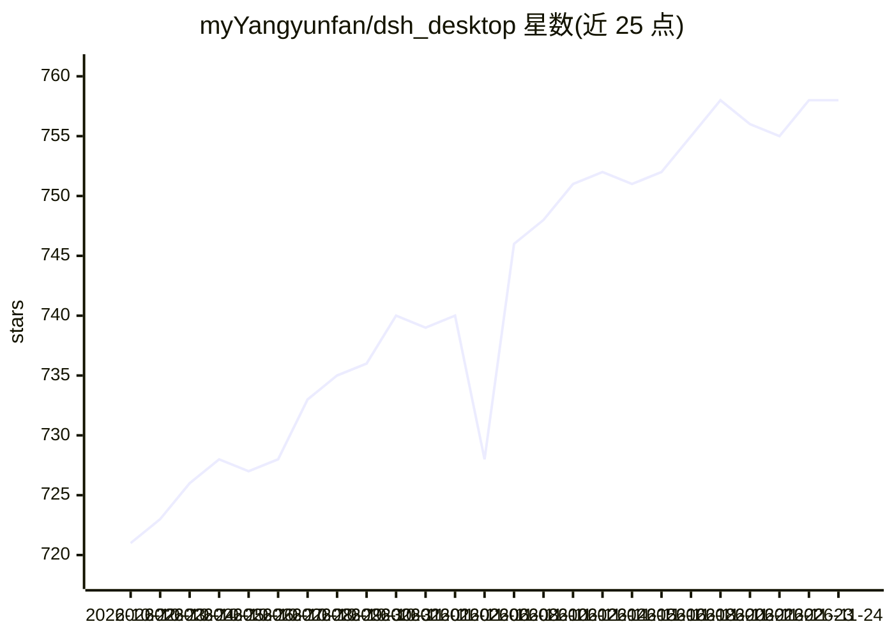

# myYangyunfan/dsh_desktop

⭐ 758 · JavaScript · MIT · 推送 2026-11-22 · [GitHub](https://github.com/myYangyunfan/dsh_desktop) · [官网](https://github.com/myYangyunfan/dsh_desktop/releases) · 个人维护 · 中文 README

**DSH 插件整合桌面客户端：免装环境一键启动**

把 dsh CLI 及 33 个精选伴随插件打包成开箱即用的桌面客户端，采用 Tauri 2（Rust）壳 + 内置独立 Node 运行时架构，目标机器无需安装 Node.js。提供 Windows 安装版与便携版（Full/Lite）、macOS dmg、Linux AppImage/deb。客户端侧机制包括：boot 守护瀑布逐级自愈、坏插件/坏配置自动修复、渲染层心跳检测、双源（GitHub/Gitee）更新链带 sha256 校验、升级覆盖安装保留 profile 与会话数据。Electron 壳自 v0.5.0 起已被 Tauri 2 替代。

## 筛选速览

| 维度 | 判定 | 备注 |
|---|---|---|
| AI 角色 | `ai-ecosystem` | LLM/agent 周边工具 |
| 许可风险 | `permissive` | MIT |
| 部署形态 | `desktop` | 安装包/桌面程序 |
| 模型依赖 | locked-api |  |
| 硬件要求 | — | 无带数字的原话,不猜 |
| 安装摩擦 | `low` | 无编译、无系统依赖或容器化 |
| 成熟度 | — | 结构信号不足 |

## 能力要点

- 随包交付完整 dsh 运行时 + 33 个精选伴随插件，标注来源仓库与许可证
- 内置独立 Node 运行时与 npm CLI，目标机器无需预装 Node.js
- 守护瀑布与崩溃自愈：坏插件自动修复、supervisor 探活 + 指数退避拉起
- 双源更新链（GitHub/Gitee）+ sha256 fail-closed 校验

## 适用场景

- 不装 Node.js 环境就想用 dsh CLI 与其插件生态
- 把 Bot 团队与群聊当成长期协作工作台使用
- 需要托盘常驻、原生通知、文件工作台的桌面体验

## 场景标签

`聊天机器人` · 领域:对话与助手

## 证据(README 行号)

> L16: > 随包交付完整 dsh 运行时 + 33 个精选伴随插件，架构是 Tauri 2 + 内置 Node：包更小、启动更快，
> L39: - **完整 dsh，离线可用** — 打包官方 `@deepseek-ai/dsh` 与官方插件全集，断网也能启动。

## 星数曲线

2026-10-22 721 → 2026-11-24 758（+37）

---
*卡片 v1 · prompt 1.4 · 生成 2026-11-24 · 置信度 high · 依据 README sha `e5e9740c1ed3` · [字段定义](../../DATASET.md)*
