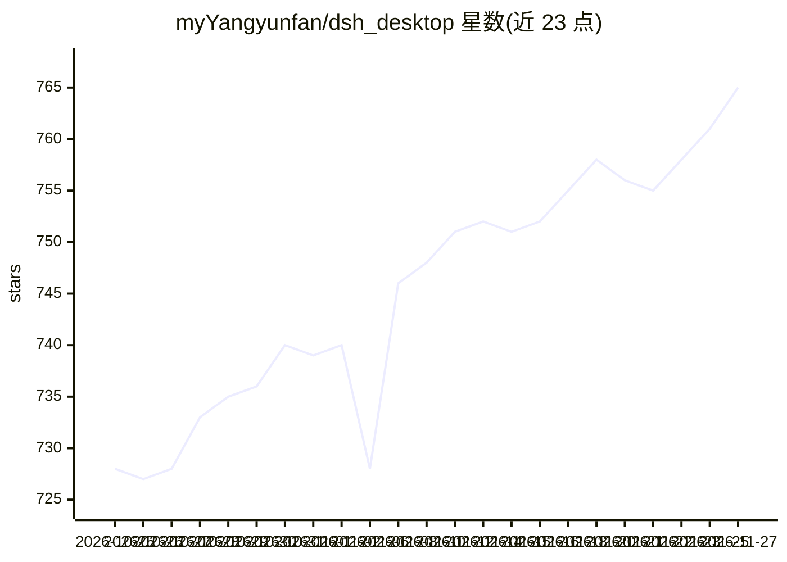

# myYangyunfan/dsh_desktop

⭐ 765 · JavaScript · MIT · 推送 2026-11-23 · [GitHub](https://github.com/myYangyunfan/dsh_desktop) · [官网](https://github.com/myYangyunfan/dsh_desktop/releases) · 个人维护 · 中文 README

**给 Windows/macOS/Linux 用户的 DeepSeek Harness 开箱即用桌面客户端**

把官方 @deepseek-ai/dsh（DeepSeek Harness CLI）与 33 个精选伴随插件打包成 Tauri 2 桌面客户端：内置独立 Node 运行时，双击启动原生窗口，无需预装 Node.js。功能覆盖插件统一启停/更新、会话归档与会话地图、Bot 团队群聊协作、文件工作台、桌面通知、余额费用显示、崩溃自愈守护与双源（GitHub/Gitee）客户端更新。提供安装版与便携版；便携 Lite 版不含内置 Node，需本机 Node ≥ 22。项目本体不注入 Agent 预设，只携带内核出厂模式集。

## 筛选速览

| 维度 | 判定 | 备注 |
|---|---|---|
| AI 角色 | `ai-ecosystem` | LLM/agent 周边工具 |
| 许可风险 | `permissive` | MIT |
| 部署形态 | `desktop` | 安装包/桌面程序 |
| 模型依赖 | locked-api |  |
| 硬件要求 | — | 无带数字的原话,不猜 |
| 安装摩擦 | `low` | 无编译、无系统依赖或容器化 |
| 成熟度 | — | 结构信号不足 |

## 能力要点

- 内置独立 Node 运行时与官方 dsh 内核，零环境依赖、离线可用
- 33 个精选插件随包交付，标注来源仓库、版本与许可证
- boot 守护瀑布与 supervisor 探活：坏插件修复、坏配置重建、崩溃自动重启
- Tauri 2 原生窗口，托盘常驻、原生通知、文件工作台

## 适用场景

- 不想手动装 Node.js 和逐个配置插件，希望一键使用 dsh
- 把 DeepSeek agent 当成长期协作工作台，用 Bot 群聊管理多个会话
- 在无网或离线机器上安装使用完整 dsh 运行时
- 用 U 盘便携版在临时机器上运行 dsh

## 场景标签

`AI 助手` · 领域:对话与助手

## 证据(README 行号)

> L3: **把 DSH 里最好用的一批插件，做成一个开箱即用的桌面客户端。**
> L39: - **完整 dsh，离线可用** — 打包官方 `@deepseek-ai/dsh` 与官方插件全集，断网也能启动。
> L16: > 随包交付完整 dsh 运行时 + 33 个精选伴随插件，架构是 Tauri 2 + 内置 Node：包更小、启动更快，

## 星数曲线

2026-10-25 728 → 2026-11-27 765（+37）

---
*卡片 v1 · prompt 1.4 · 生成 2026-11-25 · 置信度 high · 依据 README sha `0d7440cfe0d4` · [字段定义](../../DATASET.md)*
