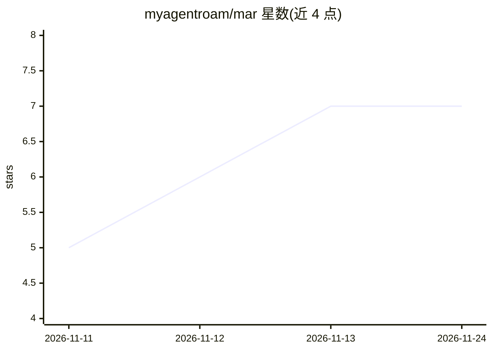

# myagentroam/mar

⭐ 7 · TypeScript · Apache-2.0 · 推送 2026-11-22 · [GitHub](https://github.com/myagentroam/mar) · [官网](https://myagentroam.dev) · 组织维护 · 中文 README

**自托管的 AI 编码代理工作台：跨设备跟踪与审查代理工作**

自托管的代理优先工作台，用于在用户自己的开发环境中运行 AI 编码代理（MAR Agent、Codex、Claude Code、OpenCode）。浏览器端设定方向与审查结果，代理在用户的 Node 机器上执行真实项目工作；支持手机查看进度与发送指令、多代理会话管理、协调者/研究者/审查者式会话树，以及 Context GC、Smart Compaction、steer、调度等长会话上下文机制。本地 CLI 已覆盖的工作流中 MAR 为可选组件。

## 筛选速览

| 维度 | 判定 | 备注 |
|---|---|---|
| AI 角色 | `ai-ecosystem` | LLM/agent 周边工具 |
| 许可风险 | `permissive` | Apache-2.0 |
| 部署形态 | `self-host` | docker 或自建部署 |
| 模型依赖 | — | README 未给出锁定关系 |
| 硬件要求 | — | 无带数字的原话,不猜 |
| 安装摩擦 | `low` | 无编译、无系统依赖或容器化 |
| 成熟度 | — | 结构信号不足 |

## 能力要点

- 支持接入 Codex、Claude Code、OpenCode 或内置 MAR Agent
- 会话树协作：协调者、独立审查、显式交接（agent_* 工具与 marctl）
- Context GC 与 Smart Compaction 的长会话上下文管理，附 50 小时会话案例数据
- 每个 apply_patch 操作保留只读 diff，文件/Git/终端可在对话旁检查

## 适用场景

- 从手机跟进桌面机器上代理的编码进度并发送指令
- 在一个界面管理多台机器上的多个代理会话
- 让协调者分发任务、独立会话审查代理产出
- 长会话编码任务中回收上下文并保持工作可审查

## 场景标签

`编码 Agent` `多智能体` · 领域:Agent 开发

## 证据(README 行号)

> L5:  A self-hosted workbench for your coding agents. Run tasks on your machines; follow progress and review changes from
> L20: **Keep your coding agent. Add a workbench for following its work across machines and devices.** You do not need to 
> L81: MAR Agent provides incremental Context GC, session continuation, planning, Skills, MCP, and tool orchestration. Use

## 星数曲线

2026-11-11 5 → 2026-11-24 7（+2）

---
*卡片 v1 · prompt 1.4 · 生成 2026-11-20 · 置信度 high · 依据 README sha `25296f1ce5e9` · [字段定义](../../DATASET.md)*
