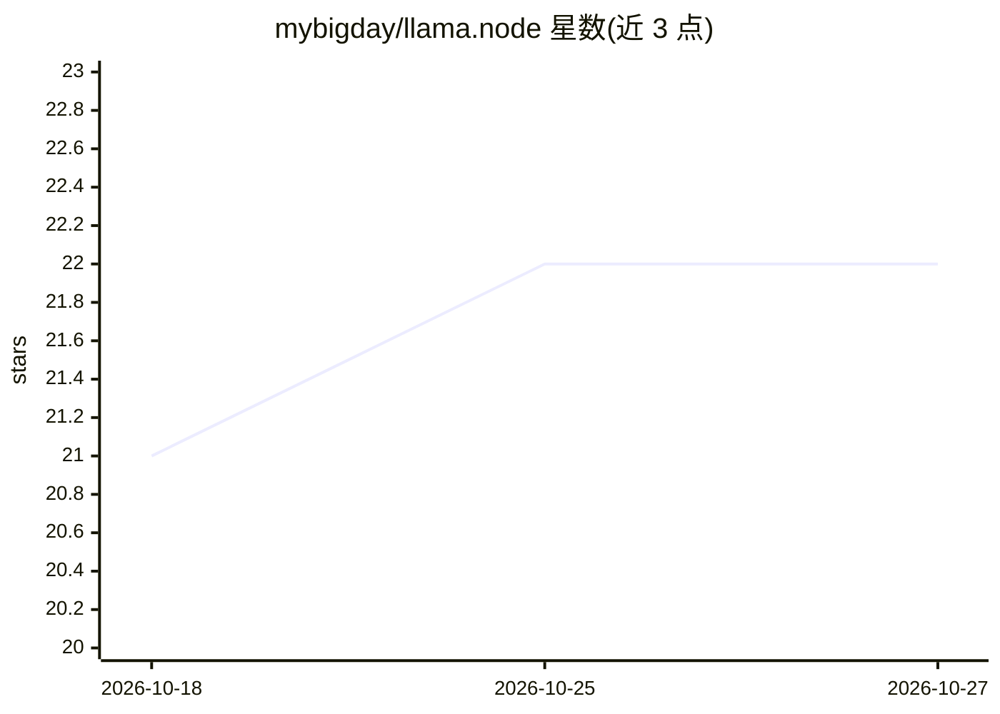

# mybigday/llama.node

⭐ 22 · C++ · 推送 2026-10-22 · [GitHub](https://github.com/mybigday/llama.node) · 个人维护

**llama.cpp 的 Node.js 绑定，供 Node 与浏览器运行 LLaMA 模型**

面向开发者的 llama.cpp Node.js 绑定，尽量与 llama.rn 保持相同 API。提供 loadModel() 加载 GGUF 模型，支持补全、嵌入、重排、多模态输入与决策模型（TypeSafe /v1/systemone API），以及实验性 TTS（OuteTTS、Qwen3-TTS 等多族模型）。平台覆盖 macOS（Metal）、Windows/Linux（Vulkan/CUDA）与 Web（WASM CPU/WebGPU），WASM 运行于 Web Worker 并带缓存策略。以 npm 包发布，MIT 许可。

## 筛选速览

| 维度 | 判定 | 备注 |
|---|---|---|
| AI 角色 | `ai-ecosystem` | LLM/agent 周边工具 |
| 许可风险 | `none` | — |
| 部署形态 | `library` | 以包/库形式分发 |
| 模型依赖 | local-ok | 支持本地模型 |
| 硬件要求 | `cpu-ok` | |
| 安装摩擦 | `high` | 编译与系统依赖俱全 |
| 成熟度 | `idea` | |

## 能力要点

- 跨平台支持：macOS Metal、Windows/Linux Vulkan/CUDA、WebAssembly CPU/WebGPU
- 支持补全、嵌入、重排、多模态与决策模型（decision API）
- 实验性 TTS 能力，覆盖 OuteTTS/Qwen3-TTS/CSM 等多个模型族
- WASM 运行于独立 Web Worker，支持模型缓存与分片加载

## 适用场景

- 在 Node.js 应用中本地运行 GGUF 格式 LLaMA 模型
- 在浏览器端通过 WASM/WebGPU 运行模型且不阻塞 UI 线程
- 复用与 llama.rn 相同 API 的跨端（Node/React Native/Web）模型推理代码

## 场景标签

`推理引擎` · 领域:训练与推理

## 证据(README 行号)

> L7: An another Node binding of llama.cpp to make same API with llama.rn as much as possible.
> L9: - llama.cpp: Inference of LLaMA model in pure C/C++

## 星数曲线

2026-10-18 21 → 2026-10-27 22（+1）

---
*卡片 v1 · prompt 1.4 · 生成 2026-10-27 · 置信度 high · 依据 README sha `bf35bc89b84c` · [字段定义](../../DATASET.md)*
