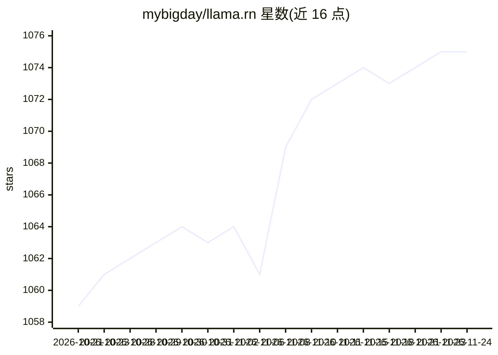

# mybigday/llama.rn

⭐ 1,076 · C · MIT · 推送 2026-11-23 · [GitHub](https://github.com/mybigday/llama.rn) · 组织维护

**React Native 开发者在移动端本地运行 llama.cpp 推理**

llama.cpp 的 React Native 绑定库，让移动应用在设备端直接运行 GGUF 模型推理。v0.10 起要求 RN 新架构；通过 postinstall 下载预编译的 iOS xcframework 与 Android jniLibs 并做 SHA-256 校验，可选从源码编译。提供 completion/tokenize/embedding/rerank 等接口，API 设计参照 llama.cpp 的 server.cpp。支持 Metal 与 Hexagon NPU 加速、经 mmproj 的视觉/音频多模态、通过 minja 与 chat.cpp 的通用工具调用、GBNF/JSON Schema 约束输出，以及槽位式并行解码与 MTP/draft-simple 投机解码。

## 筛选速览

| 维度 | 判定 | 备注 |
|---|---|---|
| AI 角色 | `ai-ecosystem` | LLM/agent 周边工具 |
| 许可风险 | `permissive` | MIT |
| 部署形态 | `library` | 以包/库形式分发 |
| 模型依赖 | local-ok | 支持本地模型 |
| 硬件要求 | — | 无带数字的原话,不猜 |
| 安装摩擦 | `medium` | 含编译或系统依赖之一 |
| 成熟度 | — | 结构信号不足 |

## 能力要点

- 设备端 GPU/NPU 加速：iOS Metal、Android Hexagon NPU（实验性）、OpenCL
- 多模态支持：图像/音频/视频输入，经 mmproj projector 接入
- 通用工具调用（Jinja 模板）与 GBNF/JSON Schema 约束生成
- 槽位式并行解码与 MTP/draft-simple 投机解码

## 适用场景

- 在 iOS/Android 应用中离线运行 GGUF 模型做对话与补全
- 在移动端集成图像或音频理解模型
- 构建支持结构化输出与工具调用的端侧 AI 功能

## 场景标签

`推理引擎` `多模态` · 领域:感知与多模态

## 证据(README 行号)

> L7: React Native binding of llama.cpp - LLM inference in C/C++
> L11: - **GPU/NPU Acceleration**: Metal (iOS), Hexagon NPU (Android, Experimental) for on-device inference
> L118: - `/completion` and `/chat/completions`: `context.completion(params, partialCompletionCallback)`

## 星数曲线

2026-10-21 1,059 → 2026-11-24 1,075（+16）

---
*卡片 v1 · prompt 1.4 · 生成 2026-11-24 · 置信度 high · 依据 README sha `7d8f820f961e` · [字段定义](../../DATASET.md)*
