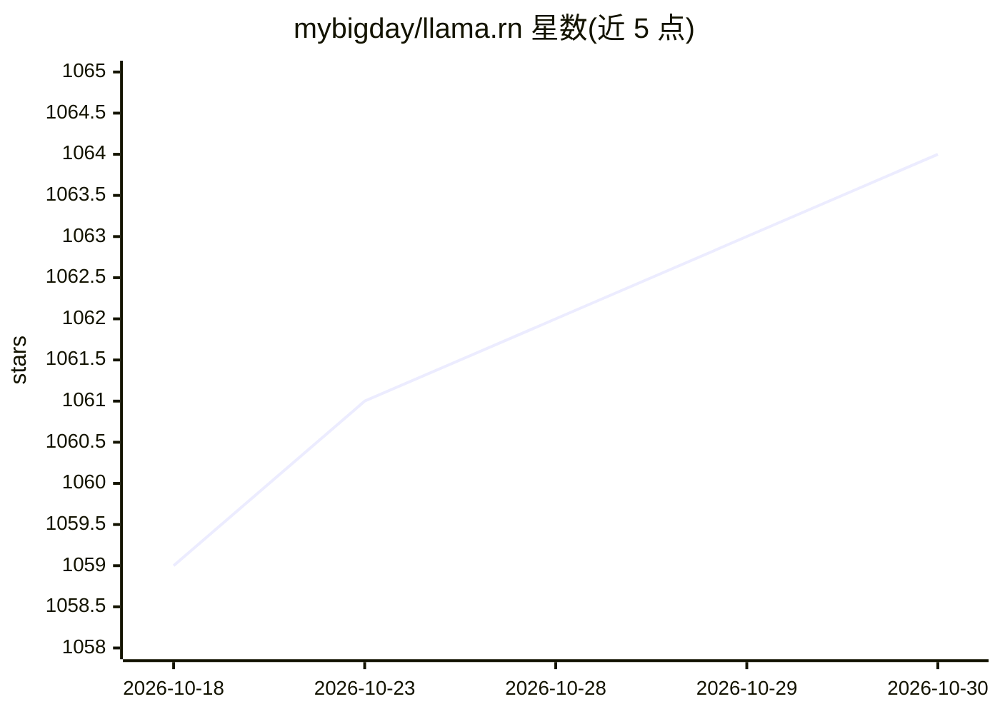

# mybigday/llama.rn

⭐ 1,064 · C · MIT · 推送 2026-10-29 · [GitHub](https://github.com/mybigday/llama.rn) · 个人维护

**在 React Native 应用中运行 llama.cpp 本地 LLM 推理的绑定库**

llama.cpp 的 React Native 绑定，供开发者在 iOS/Android 应用内做设备端 LLM 推理：加载 GGUF 模型，提供 completion、tokenize/detokenize、embedding、rerank 等 API，设计参照 llama.cpp 的 server.cpp 示例。支持 Metal/Hexagon NPU/OpenCL GPU 加速、多模态（视觉/音频，mmproj）、实验性设备端 TTS、多 slot 并行解码、基于 Jinja 模板的工具调用、GBNF/JSON Schema 约束输出与会话状态保存。npm 安装时下载预编译原生库，也可从源码构建；v0.10 起要求 React Native 新架构。

## 筛选速览

| 维度 | 判定 | 备注 |
|---|---|---|
| AI 角色 | `ai-ecosystem` | LLM/agent 周边工具 |
| 许可风险 | `permissive` | MIT |
| 部署形态 | `library` | 以包/库形式分发 |
| 模型依赖 | local-ok | 支持本地模型 |
| 硬件要求 | — | 无带数字的原话,不猜 |
| 安装摩擦 | `low` | 无编译、无系统依赖或容器化 |
| 成熟度 | `idea` | |

## 能力要点

- 加载 GGUF 模型在设备端完成 completion/embedding/rerank
- Metal (iOS)、Hexagon NPU 与 OpenCL (Android) GPU 加速
- 多模态视觉/音频理解与实验性设备端 TTS（含参考音频克隆）
- slot 并行解码、Jinja 模板工具调用、GBNF/JSON Schema 约束生成

## 适用场景

- 在 React Native 移动应用中离线运行 GGUF 模型做文本生成
- 移动端构建本地 embedding 与 rerank 的 RAG 检索
- 通过 JSON Schema 约束模型输出结构化数据

## 场景标签

`推理引擎` · 领域:训练与推理

## 证据(README 行号)

> L7: React Native binding of llama.cpp - LLM inference in C/C++
> L116: The binding's design inspired by server.cpp example in llama.cpp:

## 星数曲线

2026-10-18 1,059 → 2026-10-30 1,064（+5）

---
*卡片 v1 · prompt 1.4 · 生成 2026-10-21 · 置信度 high · 依据 README sha `2764e6987f41` · [字段定义](../../DATASET.md)*
