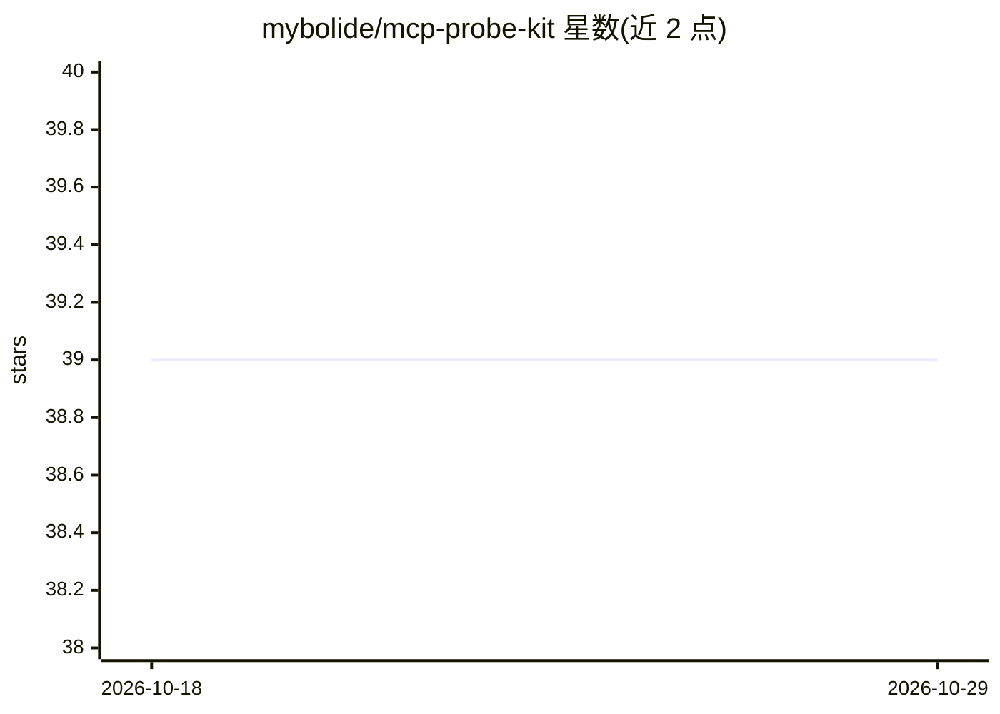

# mybolide/mcp-probe-kit

⭐ 39 · TypeScript · MIT · 推送 2026-10-28 · [GitHub](https://github.com/mybolide/mcp-probe-kit) · [官网](https://mcp-probe-kit.bytezonex.com/) · 个人维护 · 中文 README

**面向 Cursor/AI agent 的规范驱动开发 MCP 服务器**

一个 MCP（Model Context Protocol）服务器，默认向模型暴露 29 个工具（24 基础 + 5 History Session，可选配 Memory 后达 35，完整兼容面 39），覆盖从产品分析到发布的规范驱动开发工作流：start_feature/start_bugfix 等编排、可恢复委派计划与证据收敛门、无向量库的本地 History Session 会话归档、基于 GitNexus 的代码图分析，以及注入 code_review/UI 工具的质量约束规则。以 npx 运行，需 Node.js 20+，支持 Cursor、Claude Desktop、Cline 等 MCP 客户端；Memory 栈需另配 Qdrant（Docker Compose）。

## 筛选速览

| 维度 | 判定 | 备注 |
|---|---|---|
| AI 角色 | `ai-ecosystem` | LLM/agent 周边工具 |
| 许可风险 | `permissive` | MIT |
| 部署形态 | `self-host` | docker 或自建部署 |
| 模型依赖 | — | README 未给出锁定关系 |
| 硬件要求 | — | 无带数字的原话,不猜 |
| 安装摩擦 | `low` | 无编译、无系统依赖或容器化 |
| 成熟度 | — | 结构信号不足 |

## 能力要点

- 默认 29 个模型可见工具，覆盖编排/规格/架构/代码审查/UI 等工作流
- History Session 本地无损会话归档，默认开启、无需向量数据库
- plan_heartbeat/resume_plan/converge 提供可恢复计划与证据收敛门
- GitNexus 代码图桥接，不可用时自动降级

## 适用场景

- 在 Cursor/Claude Desktop 等客户端中以规范驱动流程开发功能与修 bug
- 跨会话保留项目决策与待办，供下一个 Agent 轮次恢复上下文
- 通过收敛门阻止证据不全的交付与长期记忆写入

## 场景标签

`Agent 记忆` `工作流自动化` `代码审查` · 领域:Agent 开发

## 证据(README 行号)

> L23: A powerful MCP (Model Context Protocol) server with **29 model-visible tools by default** (24 base + 5 History Sess
> L27: **Supports All MCP Clients**: Cursor, Claude Desktop, Cline, Continue, and more
> L80: - **🔄 Workflow Orchestration** (6) — `start_feature`, `start_bugfix`, `start_onboard`, `start_ui`, `start_product`,

## 星数曲线

2026-10-18 39 → 2026-10-29 39（+0）

---
*卡片 v1 · prompt 1.4 · 生成 2026-10-25 · 置信度 mid · 依据 README sha `ba10c5f8d3b0` · [字段定义](../../DATASET.md)*
