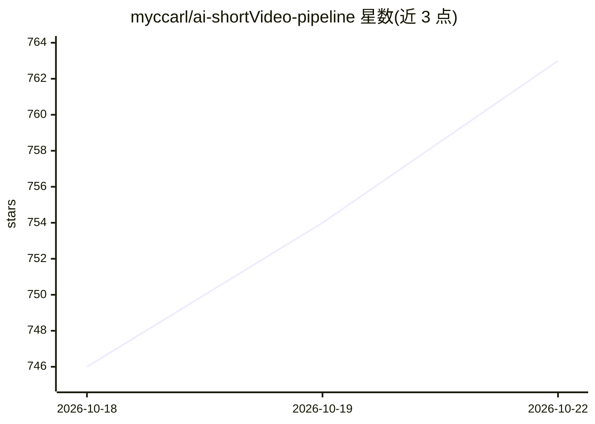

# myccarl/ai-shortVideo-pipeline

⭐ 740 · Python · MIT · 推送 2026-09-02 · [GitHub](https://github.com/myccarl/ai-shortVideo-pipeline) · 个人维护 · 中文 README

**全自动中文短视频生产流水线：一句话输入到成片发布**

开源工程化项目，覆盖选题→文案→画面→配音→后期→分发七层流水线，产出中文短视频成片。FastAPI 做编排核心，Java Spring Boot 网关负责鉴权、路由、多模型失效切换（DeepSeek/Qwen/GLM，Resilience4j 熔断）与计量。生成质量治理包括提示词锚定、CLIP 文图一致性门控、四级音画同步自动挽救；通过 Docker Compose 一键启动，需配置多家模型服务 API key。

## 筛选速览

| 维度 | 判定 | 备注 |
|---|---|---|
| AI 角色 | `ai-native` | 本体是模型或模型工具 |
| 许可风险 | `permissive` | MIT |
| 部署形态 | `self-host` | docker 或自建部署 |
| 模型依赖 | locked-api |  |
| 硬件要求 | — | 无带数字的原话,不猜 |
| 安装摩擦 | `low` | 无编译、无系统依赖或容器化 |
| 成熟度 | — | 结构信号不足 |

## 能力要点

- 七层解耦流水线架构，各层可独立替换
- 多模型失效切换与熔断保护（Java 网关聚合 DeepSeek/Qwen/GLM）
- CLIP 文图一致性门控与四级音画同步自动挽救
- 全链路 trace_id 贯穿 Java/Python，Langfuse 调用树观测

## 适用场景

- 批量自动生产热点评论、知识讲解等中文短视频
- 通过 webhook/storyboard API 接入自动化视频生产
- 研究多模型网关治理与生成质量门控的工程实现

## 场景标签

`视频生成` `AI 写作` `语音合成` · 领域:内容生成

## 证据(README 行号)

> L11: `myAiVideos` is an open-source engineering project for automated Chinese-language short-video production, covering 
> L3: > An end-to-end automated short-video production pipeline. One command in, a publish-ready video out.

## 星数曲线

2026-10-18 746 → 2026-10-22 763（+17）

---
*卡片 v1 · prompt 1.4 · 生成 2026-10-21 · 置信度 high · 依据 README sha `098176a223eb` · [字段定义](../../DATASET.md)*
