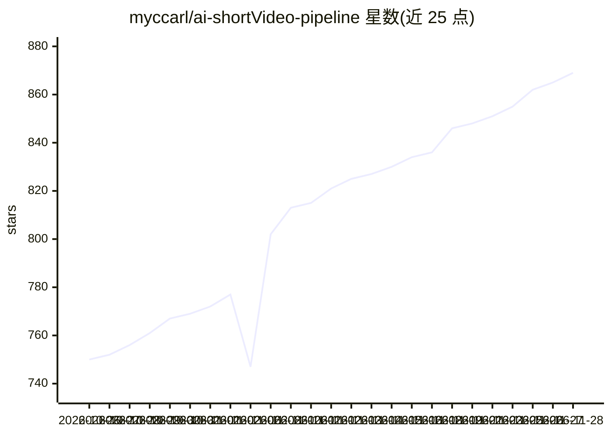

# myccarl/ai-shortVideo-pipeline

⭐ 869 · Python · MIT · 推送 2026-11-13 · [GitHub](https://github.com/myccarl/ai-shortVideo-pipeline) · 个人维护 · 中文 README

**面向中文短视频创作者的端到端自动化生产流水线**

覆盖选题→创意→视觉→音频→后期→分发→优化七层解耦架构的中文短视频自动生产工程。FastAPI 编排核心，Spring Boot 网关承担鉴权、路由、熔断、计量与可观测性，聚合 DeepSeek/Qwen/GLM 等模型并自动故障切换。质量门控包括 prompt 锚定保持主体视觉一致、CLIP 图文一致性拦截、四级音画同步自动修复。通过 Docker Compose 一键启动，需配置各家模型 API key。

## 筛选速览

| 维度 | 判定 | 备注 |
|---|---|---|
| AI 角色 | `ai-native` | 本体是模型或模型工具 |
| 许可风险 | `permissive` | MIT |
| 部署形态 | `self-host` | docker 或自建部署 |
| 模型依赖 | locked-api |  |
| 硬件要求 | — | 无带数字的原话,不猜 |
| 安装摩擦 | `low` | 无编译、无系统依赖或容器化 |
| 成熟度 | — | 结构信号不足 |

## 能力要点

- 七层解耦流水线，各层可独立替换
- Java 网关多模型故障切换 + Resilience4j 熔断
- CLIP 图文一致性门控与音画同步自动修复
- Langfuse 跨语言 trace_id 调用树可观测

## 适用场景

- 批量自动生成热点评论类短视频
- 一键产出知识科普/情感故事内容并直接可发布
- 对多模型调用做计量、限流与成本核算

## 场景标签

`视频生成` `工作流自动化` · 领域:效率与自动化

## 证据(README 行号)

> L15: `myAiVideos` is an open-source engineering project for automated Chinese-language short-video production, covering 
> L28: - **Multi-model failover + circuit breaker**: Java gateway aggregates DeepSeek / Qwen / GLM with Resilience4j prote
> L46: |AI Models|DeepSeek · Zhipu GLM-4V · Kling v2.5 · Volcengine / MiniMax TTS · faster-whisper|

## 星数曲线

2026-10-26 750 → 2026-11-28 869（+119）

---
*卡片 v1 · prompt 1.4 · 生成 2026-11-24 · 置信度 high · 依据 README sha `724e09d628fe` · [字段定义](../../DATASET.md)*
