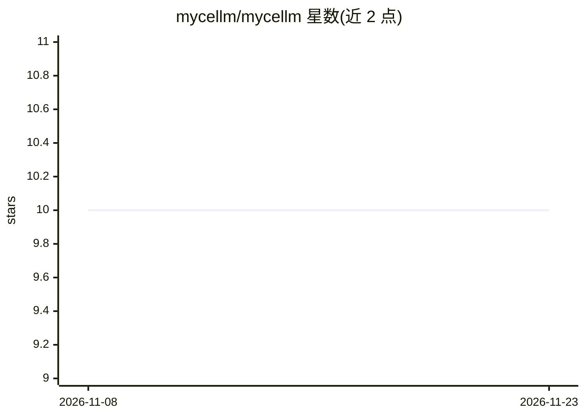

# mycellm/mycellm

⭐ 10 · Python · Apache-2.0 · 推送 2026-08-25 · [GitHub](https://github.com/mycellm/mycellm) · [官网](https://mycellm.ai) · 组织维护

**把分布各处的 GPU 组成 P2P 网络做分布式 LLM 推理**

mycellm 将互联网上的 GPU 汇聚为单一推理网络：消费端通过 OpenAI 兼容 API（/v1/chat/completions）发送请求，经 QUIC 传输与 NAT 穿透路由到贡献算力的 seeder 节点，由 llama.cpp/vLLM/MLX 后端执行推理并流式返回 token。采用 Ed25519 签名收据的积分经济，贡献算力赚积分、消费扣积分；含隐私扫描（敏感 prompt 自动转本地模型）、邀请制私有网络与车队管理。安装途径为 pip、安装脚本与 Docker，另提供 iOS 原生应用。

## 筛选速览

| 维度 | 判定 | 备注 |
|---|---|---|
| AI 角色 | `ai-ecosystem` | LLM/agent 周边工具 |
| 许可风险 | `permissive` | Apache-2.0 |
| 部署形态 | `self-host` | docker 或自建部署 |
| 模型依赖 | local-ok | 支持本地模型 |
| 硬件要求 | — | 无带数字的原话,不猜 |
| 安装摩擦 | `low` | 无编译、无系统依赖或容器化 |
| 成熟度 | — | 结构信号不足 |

## 能力要点

- QUIC 传输 + NAT 穿透，跨互联网 P2P 组网推理
- OpenAI 兼容 API，可作 Claude Code/aider/Continue.dev 等工具的后端
- 多推理后端：llama.cpp（Metal/CUDA/ROCm/CPU）、vLLM、MLX、MLX-VLM 多模态
- Ed25519 签名收据的积分经济与邀请制私有网络

## 适用场景

- 把家里多台设备的 GPU 池化为一个统一推理端点
- 为实验室建私有推理网络，共享院系 GPU 并按积分限流
- 给 OpenAI 兼容的编码工具提供本地模型后端
- 用 iPad 作为网络节点提供推理并赚取积分

## 场景标签

`推理引擎` `模型网关` · 领域:Agent 开发

## 证据(README 行号)

> L23: mycellm pools GPUs across the internet into a single inference network. Contribute compute and earn credits. Chat w
> L28: - **OpenAI-compatible API** — drop-in replacement at `/v1/chat/completions`. Works with Claude Code, aider, Continu
> L96: |**Roots**|Inference compute|llama.cpp (Metal/CUDA/ROCm/CPU), vLLM|

## 星数曲线

2026-11-08 10 → 2026-11-23 10（+0）

---
*卡片 v1 · prompt 1.4 · 生成 2026-11-19 · 置信度 high · 依据 README sha `030e2c50db0f` · [字段定义](../../DATASET.md)*
