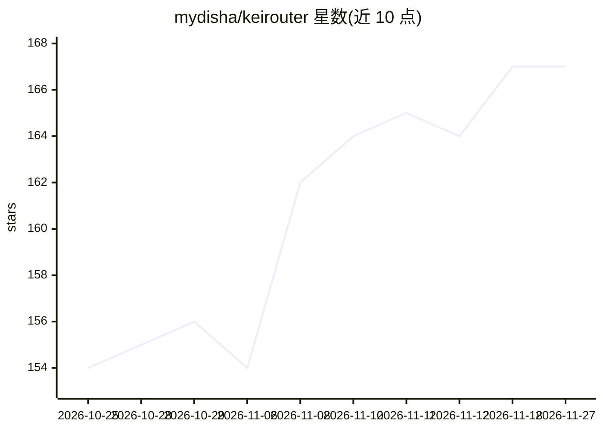

# mydisha/keirouter

⭐ 167 · Go · MIT · 推送 2026-11-19 · [GitHub](https://github.com/mydisha/keirouter) · [官网](https://keirouter.app) · 个人维护

**自托管 AI 网关：为编码工具统一接入多模型并控制成本**

用 Go 编写的自托管 AI 网关，将 Claude Code、Codex、Cursor、Cline 等编码工具的请求汇聚到单一本地端点，在 OpenAI、Anthropic、Gemini 等协议间转换，并按优先级、轮询、延迟或成本排序执行 fallback 链。内置响应缓存、五项 token 节省器、按 key 的预算与限流引擎、PII/注入/毒性等分层护栏、哈希链审计日志与 Prometheus 指标。以单二进制加静态 dashboard 分发，HA 部署依赖 Postgres 与 Redis。

## 筛选速览

| 维度 | 判定 | 备注 |
|---|---|---|
| AI 角色 | `ai-ecosystem` | LLM/agent 周边工具 |
| 许可风险 | `permissive` | MIT |
| 部署形态 | `self-host` | docker 或自建部署 |
| 模型依赖 | local-ok | 支持本地模型 |
| 硬件要求 | — | 无带数字的原话,不猜 |
| 安装摩擦 | `low` | 无编译、无系统依赖或容器化 |
| 成熟度 | `idea` | |

## 能力要点

- 单端点多协议转换（OpenAI Chat/Responses、Anthropic Messages、原生 Gemini）
- fallback 链按优先级/轮询/延迟/成本排序，附 24h/7d 提供商健康历史
- 预算引擎按 key 设置 USD 与 token 硬限并自动切断
- 支持 AWS Bedrock、Azure AI Foundry、IBM watsonx.ai 等企业云原生接入

## 适用场景

- 为多个 AI 编码工具统一管理 API key 并自动故障转移
- 按 key 设置预算和限流以控制团队 token 支出
- 部署带 PII 与 prompt 注入检测的合规网关

## 场景标签

`模型网关` `编码 Agent` · 领域:Agent 开发

## 证据(README 行号)

> L5:  Your friendly, blazing-fast, self-hostable AI gateway.
> L16: You use AI coding tools — Claude Code, Codex, Cursor, Cline, or honestly anything that talks to OpenAI, Anthropic o
> L18: **KeiRouter is the smart middleman that makes all of that someone else's problem.** Point your tools at one local e

## 星数曲线

2026-10-25 154 → 2026-11-27 167（+13）

---
*卡片 v1 · prompt 1.4 · 生成 2026-11-27 · 置信度 mid · 依据 README sha `5474e38bace1` · [字段定义](../../DATASET.md)*
