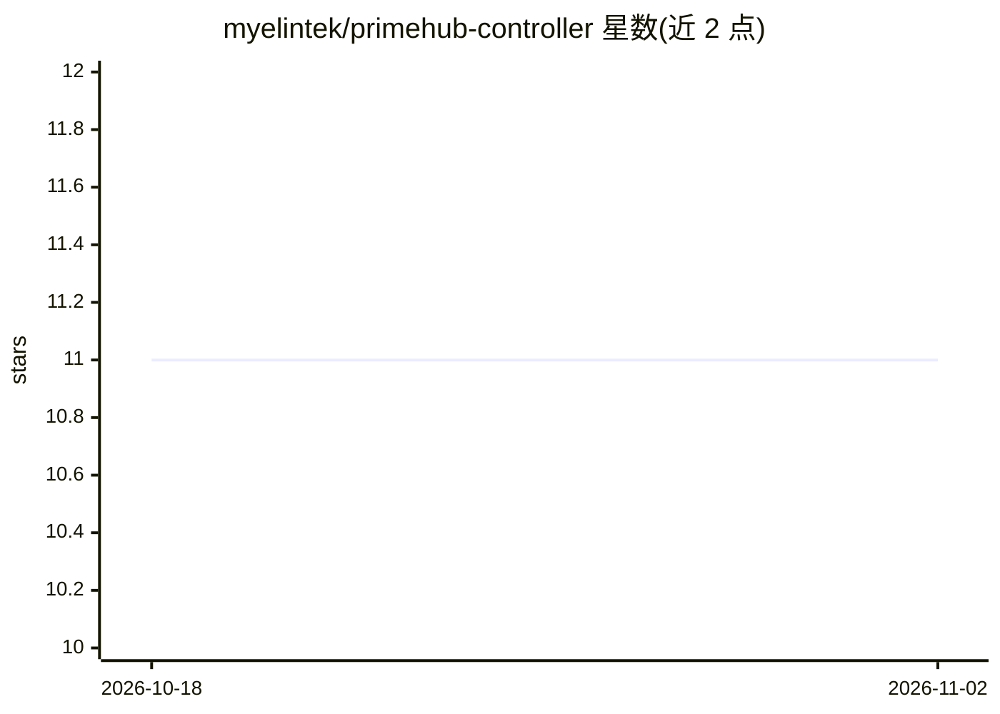

# myelintek/primehub-controller

⭐ 11 · Go · NOASSERTION · 推送 2026-07-03 · [GitHub](https://github.com/myelintek/primehub-controller) · 组织维护

**PrimeHub 平台的 Kubernetes 控制器：管理用户自定义镜像构建**

PrimeHub 机器学习平台的 Kubernetes 控制器组件，提供自定义镜像功能：通过 ConfigMap 注入构建与推送脚本，使用 Docker registry secret 将构建出的镜像推送到容器仓库，并通过 config.yaml 进行配置。面向在 Kubernetes 上部署运维 PrimeHub 的平台管理员或开发者。README 仅覆盖配置步骤，未说明其他功能细节；仓库带 CE/EE 的 Docker 构建与 CircleCI、codecov 集成标识。

## 筛选速览

| 维度 | 判定 | 备注 |
|---|---|---|
| AI 角色 | `ai-ecosystem` | LLM/agent 周边工具 |
| 许可风险 | `none` | NOASSERTION |
| 部署形态 | `None` |  |
| 模型依赖 | — | README 未给出锁定关系 |
| 硬件要求 | — | 无带数字的原话,不猜 |
| 安装摩擦 | `low` | 无编译、无系统依赖或容器化 |
| 成熟度 | — | 结构信号不足 |

## 能力要点

- 以 Kubernetes Controller 形式运行于 PrimeHub 平台
- 自定义镜像：ConfigMap 注入 build-and-push 脚本
- 构建镜像经 push secret 推送到容器仓库
- 通过 config.yaml 配置

## 适用场景

- 在 PrimeHub 中启用用户自定义镜像构建
- 将构建镜像推送到私有容器仓库
- 运维 PrimeHub 平台的 Kubernetes 组件

## 场景标签

 · 领域:机器学习平台基础设施

## 证据(README 行号)

> L8: # PrimeHub Controller
> L10: ## Custom Image

## 星数曲线

2026-10-18 11 → 2026-11-02 11（+0）

---
*卡片 v1 · prompt 1.4 · 生成 2026-11-01 · 置信度 mid · 依据 README sha `6294a32d6c5a` · [字段定义](../../DATASET.md)*
