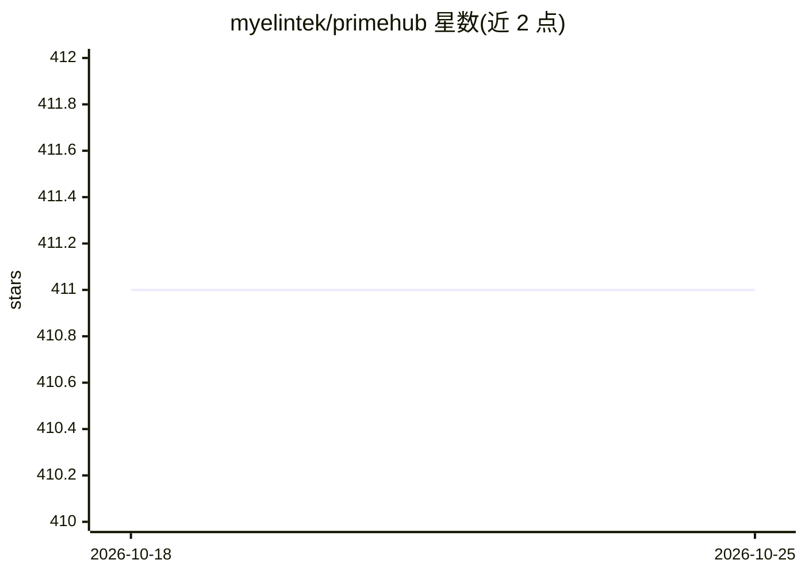

# myelintek/primehub

⭐ 411 · Shell · Apache-2.0 · 推送 2026-01-13 · [GitHub](https://github.com/myelintek/primehub) · [官网](https://docs.primehub.io) · 组织维护

**Kubernetes 上的开源 MLOps 平台，面向团队提供 ML 基础设施**

PrimeHub Community Edition 是构建在 Kubernetes 之上的机器学习基础设施平台，提供集群计算、一键式研究环境（JupyterHub 分发版）、多种数据集加载与上传、实例/镜像/密钥管理、基于群组与用户的资源管理和访问控制，采用以项目/团队为中心的设计。面向 IT 管理者可配置资源并管理生产化工作负载；面向数据科学家提供几步即用的 Jupyter Notebook 环境。本仓库包含 PrimeHub CE 的 Helm Chart 及安装指南，CE 提供 Enterprise Edition 的部分基础功能。

## 筛选速览

| 维度 | 判定 | 备注 |
|---|---|---|
| AI 角色 | `ai-ecosystem` | LLM/agent 周边工具 |
| 许可风险 | `permissive` | Apache-2.0 |
| 部署形态 | `library` | 以包/库形式分发 |
| 模型依赖 | — | README 未给出锁定关系 |
| 硬件要求 | — | 无带数字的原话,不猜 |
| 安装摩擦 | `low` | 无编译、无系统依赖或容器化 |
| 成熟度 | — | 结构信号不足 |

## 能力要点

- 构建于 Kubernetes 之上的集群计算与资源管理
- 一键式 JupyterHub 研究环境（含 SSH 远程访问）
- 群组/用户级资源管理与访问控制
- 数据集上传与多类型数据集支持

## 适用场景

- 团队在 Kubernetes 上统一管理 ML 研究环境与资源配额
- IT 管理者为数据科学家配置并管控计算资源
- 通过 Helm 部署自托管 MLOps 基础设施

## 场景标签

`MLOps` · 领域:训练与推理

## 证据(README 行号)

> L12: Welcome to the PrimeHub Community Edition repository, **PrimeHub** is an effortless infrastructure for machine lear
> L59: PrimeHub is built on top of well-designed distributed systems. We use Kubernetes as the orchestration platform and 

## 星数曲线

2026-10-18 411 → 2026-10-25 411（+0）

---
*卡片 v1 · prompt 1.4 · 生成 2026-10-21 · 置信度 high · 依据 README sha `149f2f812cab` · [字段定义](../../DATASET.md)*
