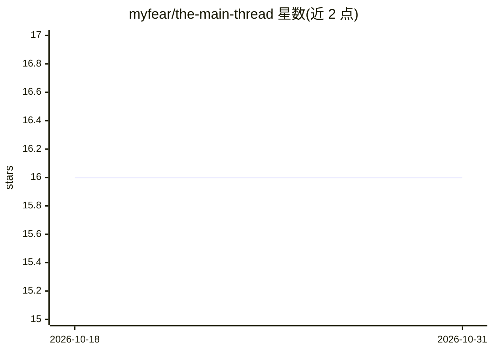

# myfear/the-main-thread

⭐ 16 · Java · Apache-2.0 · 推送 2026-10-26 · [GitHub](https://github.com/myfear/the-main-thread) · [官网](https://www.the-main-thread.com/) · 个人维护

**企业 Java 与 AI 集成文章的配套示例代码集合**

The Main Thread（Substack 出版物）的源码仓库：每个文件夹对应一篇文章，收录 150+ 个 Quarkus/LangChain4j 相关配套工程，覆盖云原生应用、微服务安全（Vault/TOTP）、AI 服务集成、RAG、Kubernetes 等主题。目录以表格形式记录各工程的 Java 版本、Quarkus 版本、测试数与 CI 构建状态（含 Not configured/Not yet built 等标注）。面向构建真实企业系统的开发者，含 Maven、Gradle、JBang 与脚本示例。

## 筛选速览

| 维度 | 判定 | 备注 |
|---|---|---|
| AI 角色 | `ai-knowledge` | 知识聚合/清单类 |
| 许可风险 | `permissive` | Apache-2.0 |
| 部署形态 | `None` |  |
| 模型依赖 | — | README 未给出锁定关系 |
| 硬件要求 | — | 无带数字的原话,不猜 |
| 安装摩擦 | `medium` | 含编译或系统依赖之一 |
| 成熟度 | — | 结构信号不足 |

## 能力要点

- 150+ 篇文章配套工程，每文件夹对应一篇文章
- 覆盖 Quarkus、LangChain4j、RAG、Vault、Kubernetes 等主题
- 目录表记录各工程的 Java/Quarkus 版本、测试数与 CI 构建状态
- 提供 Maven、Gradle、JBang 及脚本多种构建形态

## 适用场景

- 查找企业 Java 与 AI 集成的可运行示例代码
- 跟随文章动手实践 Quarkus 与 LangChain4j 集成
- 查看各示例工程的测试与构建状态

## 场景标签

`教程课程` · 领域:学习与行业

## 证据(README 行号)

> L3: Welcome to The Main Thread — your strategic companion for navigating the evolving world of enterprise Java, software
> L18: Each folder in this repository matches an article from the Substack and includes:

## 星数曲线

2026-10-18 16 → 2026-10-31 16（+0）

---
*卡片 v1 · prompt 1.4 · 生成 2026-10-30 · 置信度 mid · 依据 README sha `672ca1868c7f` · [字段定义](../../DATASET.md)*
