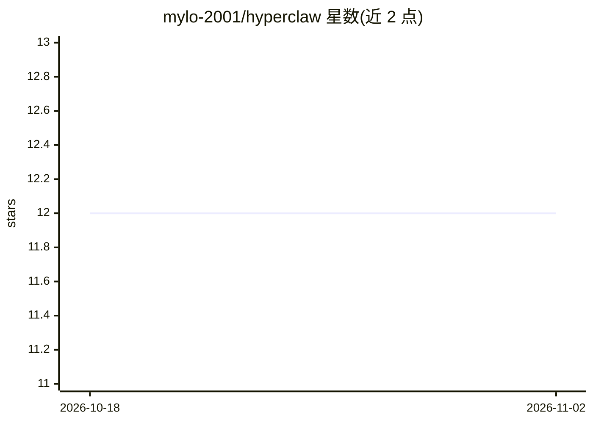

# mylo-2001/hyperclaw

⭐ 12 · TypeScript · MIT · 推送 2026-03-12 · [GitHub](https://github.com/mylo-2001/hyperclaw) · 个人维护

**本地运行的个人 AI 网关：把 AI 助手接入 Telegram 等 28+ 聊天渠道**

运行在用户自己机器上的 AI 网关平台：以 Node.js 守护进程形式启动，将 AI 助手连接到 Telegram、Discord、WhatsApp、Slack、iMessage 等 28+ 消息渠道，并提供 WebChat、CLI、Dashboard 与语音会话。支持 20+ 模型提供商（Anthropic、OpenAI、Google、Ollama 本地模型及任意 OpenAI 兼容端点）。内置 MCP 协议、Docker 沙箱执行、安全审计命令、配置热重载，以及面向授权安全研究的 OSINT 模式。要求 Node ≥ 22，一条 npm 命令安装，Windows/macOS/Linux 原生运行。

## 筛选速览

| 维度 | 判定 | 备注 |
|---|---|---|
| AI 角色 | `ai-native` | 本体是模型或模型工具 |
| 许可风险 | `permissive` | MIT |
| 部署形态 | `desktop` | 安装包/桌面程序 |
| 模型依赖 | local-ok | 支持本地模型 |
| 硬件要求 | — | 无带数字的原话,不猜 |
| 安装摩擦 | `low` | 无编译、无系统依赖或容器化 |
| 成熟度 | — | 结构信号不足 |

## 能力要点

- 28+ 消息渠道内置（Telegram/Discord/WhatsApp/Signal/iMessage 等）
- 支持 20+ AI 提供商，含 Ollama/LM Studio 本地模型与 OpenAI 兼容自定义端点
- 守护进程后台运行，配置热重载无需重启
- 内置安全审计（--fix）、DM 配对/白名单默认开启、Docker 沙箱与 MCP 协议

## 适用场景

- 在自己电脑上跑一个 AI 助手，通过 Telegram/Discord 随时对话
- 安全研究人员经手机渠道驱动 recon、漏洞赏金与报告起草工作流
- 开发者用本地 shell、GitHub 集成与跨会话记忆辅助编码
- 家庭自动化：定时任务技能、晨报、日历与设备指令

## 场景标签

`AI 助手` `模型网关` · 领域:Agent 开发

## 证据(README 行号)

> L3:  Your personal AI assistant — running on your hardware, talking on your channels.
> L342: HyperClaw supports 20+ providers. Pick one in the wizard or set `provider.providerId` in config:

## 星数曲线

2026-10-18 12 → 2026-11-02 12（+0）

---
*卡片 v1 · prompt 1.4 · 生成 2026-11-01 · 置信度 high · 依据 README sha `4d58947b9474` · [字段定义](../../DATASET.md)*
