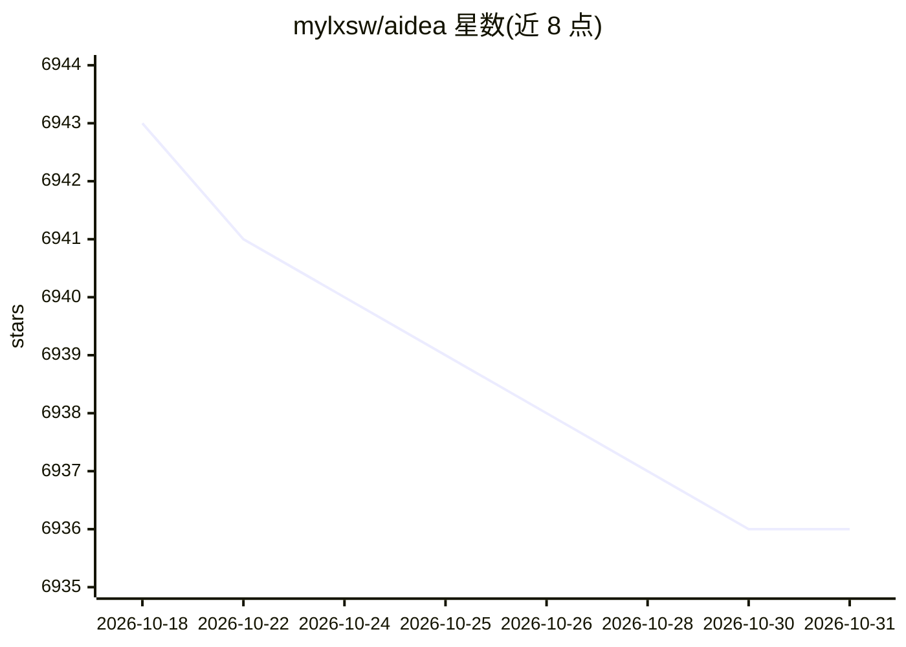

# mylxsw/aidea

⭐ 6,936 · Dart · MIT · 推送 2026-03-04 · [GitHub](https://github.com/mylxsw/aidea) · [官网](https://ai.aicode.cc) · 个人维护 · 中文 README

**集成主流大模型与图像生成模型的开源聊天应用**

基于 Flutter 构建的 AI 应用，集成主流大语言模型与图像生成模型，支持聊天、协作与图像生成，代码完全开源。客户端与服务端分离（aidea / aidea-server），提供 Docker 部署仓库与托管云服务；不愿使用云服务的用户可自行部署服务端，也可联系作者获得付费协助部署。当前 main 分支为开发中的 v2 版本，自部署需切换到 v1.x 分支。截图显示支持移动端、macOS 与 Windows 界面。

## 筛选速览

| 维度 | 判定 | 备注 |
|---|---|---|
| AI 角色 | `ai-native` | 本体是模型或模型工具 |
| 许可风险 | `permissive` | MIT |
| 部署形态 | `None` |  |
| 模型依赖 | — | README 未给出锁定关系 |
| 硬件要求 | — | 无带数字的原话,不猜 |
| 安装摩擦 | `low` | 无编译、无系统依赖或容器化 |
| 成熟度 | `idea` | |

## 能力要点

- Flutter 构建，覆盖移动端/macOS/Windows 多端界面
- 客户端、服务端、Docker 部署仓库全部开源（MIT）
- 支持自托管私有部署，提供托管云服务与付费协助部署两种替代

## 适用场景

- 在一个应用中使用多家主流大模型进行聊天与图像生成
- 自托管部署服务端供团队私有使用
- 基于开源客户端与服务端二次开发自己的 AI 应用

## 场景标签

`聊天机器人` `图像生成` · 领域:对话与助手

## 证据(README 行号)

> L11: An APP that integrates mainstream large language models and image generation models, built with Flutter, with fully
> L45: If you do not want to use the managed cloud service, you can deploy the server yourself. See deployment instruction

## 星数曲线

2026-10-18 6,943 → 2026-10-31 6,936（-7）

---
*卡片 v1 · prompt 1.4 · 生成 2026-10-20 · 置信度 high · 依据 README sha `888799a4913a` · [字段定义](../../DATASET.md)*
