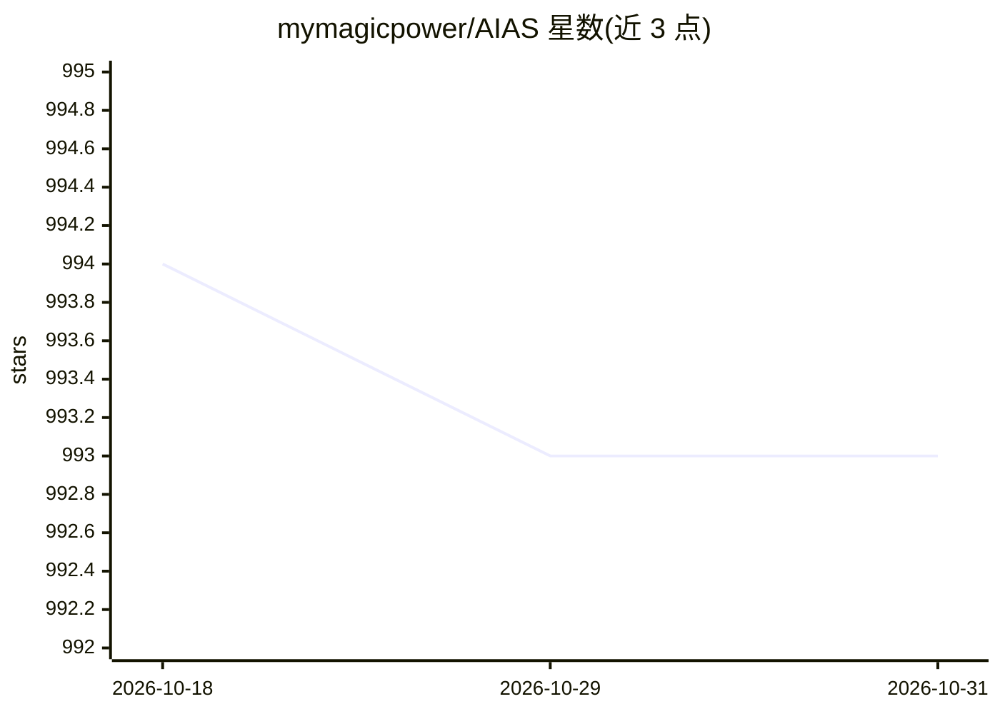

# mymagicpower/AIAS

⭐ 993 · Java · Apache-2.0 · 推送 2026-05-05 · [GitHub](https://github.com/mymagicpower/AIAS) · [官网](http://aias.top) · 个人维护 · 中文 README

**面向 Java 程序员的 AI 一站式工具箱：训练平台+Web应用+能力API**

以 Java 为主要语言的全家桶式 AI 解决方案，分三部分：面向 Java 程序员的图像分类模型训练平台（以 REST API 提供接口）；可直接部署的 AI Web 应用（VUE+Springboot），涵盖自定义模板 IOCR、以图搜图、跨模态以文搜图、人脸搜索、一键抠图、图像生成与文本搜索/RAG；AI 能力平台以 API 提供 OCR、202 种语言翻译、语音识别、图像增强等。模型经百度网盘分发，支持 CPU 与 GPU (CUDA) 环境，Windows/Linux/macOS x64。

## 筛选速览

| 维度 | 判定 | 备注 |
|---|---|---|
| AI 角色 | `ai-native` | 本体是模型或模型工具 |
| 许可风险 | `permissive` | Apache-2.0 |
| 部署形态 | `None` |  |
| 模型依赖 | — | README 未给出锁定关系 |
| 硬件要求 | — | 无带数字的原话,不猜 |
| 安装摩擦 | `medium` | 含编译或系统依赖之一 |
| 成熟度 | — | 结构信号不足 |

## 能力要点

- 自定义模板 IOCR（锚点+内容识别区设置）
- 以图搜图/以文搜图/人脸搜索均提供无向量引擎与向量引擎两个版本（按百万级数据划分）
- AI 能力平台提供 OCR、翻译、语音识别、图像增强等 REST API
- 面向 Java 程序员的分类模型训练平台，训练能力以 REST API 输出

## 适用场景

- Java 团队快速搭建以图搜图或人脸搜索检索系统
- 用自定义模板做票据/证照类 OCR 识别
- 通过 API 集成 OCR、翻译、语音识别等到现有系统
- 结合大模型用文本搜索搭建 RAG 应用

## 场景标签

`OCR` `语音识别` `图像生成` `RAG` · 领域:内容生成

## 证据(README 行号)

> L25: ### 1: 面向 Java 程序员的 AI 训练平台【模型定制】
> L43:   1). 图像生成
> L195:   1). OCR文字识别

## 星数曲线

2026-10-18 994 → 2026-10-31 993（-1）

---
*卡片 v1 · prompt 1.4 · 生成 2026-10-21 · 置信度 high · 依据 README sha `47f24f9f9ea8` · [字段定义](../../DATASET.md)*
