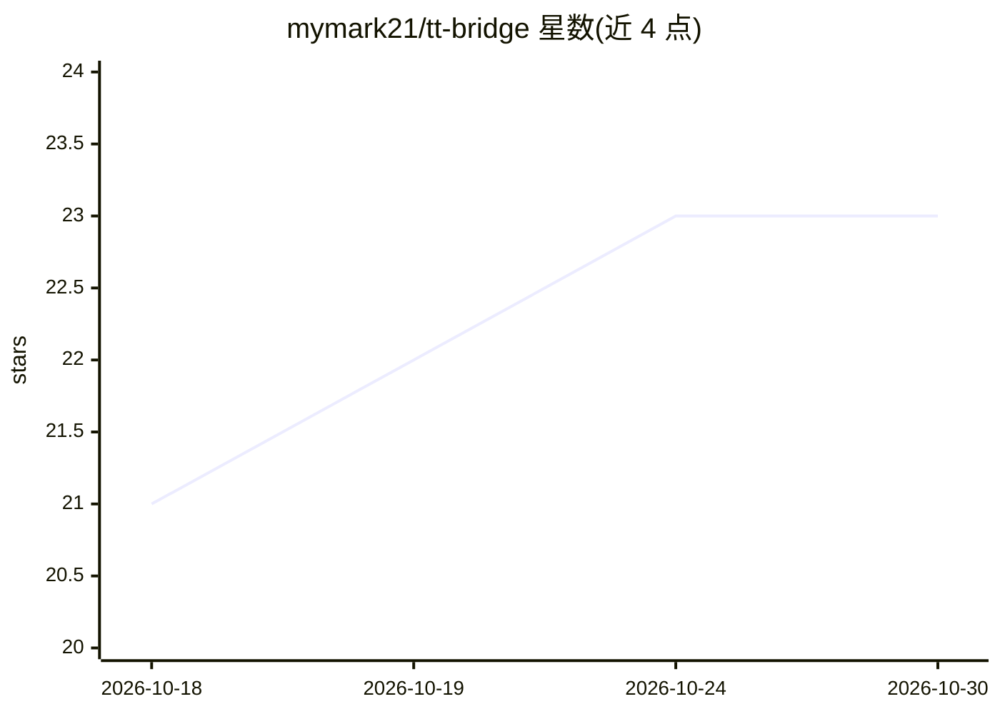

# mymark21/tt-bridge

⭐ 23 · JavaScript · NOASSERTION · 推送 2026-10-19 · [GitHub](https://github.com/mymark21/tt-bridge) · 个人维护 · 中文 README

**让 Claude Code 等 Agent 直接接管用户浏览器的 CLI 与 Chrome 扩展**

由个人开发者 Terry Tang 开源的浏览器控制桥接工具，含 CLI 与 Chrome 扩展两部分：AI Agent 通过 CLI 命令（open/eval/click/screenshot 等）接管用户当前 Chrome 窗口的登录状态、cookie、滚动、点击与输入，无需反复授权；支持以 workspace 隔离自动化任务。安装方式为从 GitHub Release 下载 zip 解压后 npm install -g .，并手动加载扩展，README 明确警告不要使用 npm 上的同名包。面向使用 Claude Code、Codex、Cursor 等 Agent 产品的开发者。

## 筛选速览

| 维度 | 判定 | 备注 |
|---|---|---|
| AI 角色 | `ai-ecosystem` | LLM/agent 周边工具 |
| 许可风险 | `none` | NOASSERTION |
| 部署形态 | `desktop` | 安装包/桌面程序 |
| 模型依赖 | locked-api |  |
| 硬件要求 | — | 无带数字的原话,不猜 |
| 安装摩擦 | `low` | 无编译、无系统依赖或容器化 |
| 成熟度 | — | 结构信号不足 |

## 能力要点

- CLI 命令覆盖导航、eval、点击、输入、截图、会话管理
- 默认操作用户当前可见的 Chrome 窗口，保留登录状态与 cookie
- 支持 --workspace 隔离自动化任务
- 面向 Agent 产品的完整安装 Prompt，由 AI 引导用户安装

## 适用场景

- 让 Claude Code 等 Agent 直接在我的浏览器里完成数据采集、填表、发推等任务
- 复用现有登录态做页面自动化与 RPA
- 为自动化任务分配隔离 workspace 避免干扰正常浏览

## 场景标签

`浏览器自动化` · 领域:效率与自动化

## 证据(README 行号)

> L7: > 它干的事情很简单：**你看到什么，AI 就看到什么。** 登录状态、cookie、滚动、点击、输入……AI 全部直接接管，不需要反复授权。
> L21: 无论你在用 Claude Code、Codex、Cursor、Workbody，还是其他 Agent 类产品，把下面这段话发给它就行：

## 星数曲线

2026-10-18 21 → 2026-10-30 23（+2）

---
*卡片 v1 · prompt 1.4 · 生成 2026-10-27 · 置信度 high · 依据 README sha `d7c1023fadb3` · [字段定义](../../DATASET.md)*
