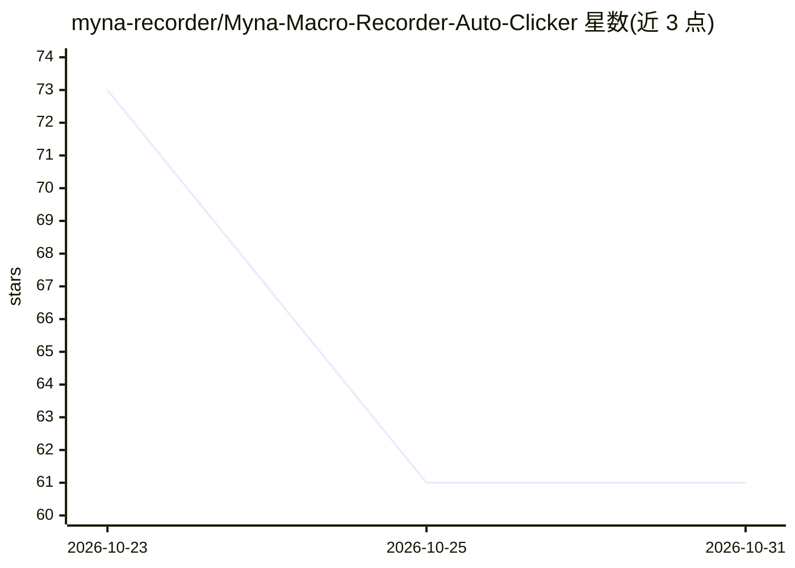

# myna-recorder/Myna-Macro-Recorder-Auto-Clicker

⭐ 61 · 推送 2026-10-18 · [GitHub](https://github.com/myna-recorder/Myna-Macro-Recorder-Auto-Clicker) · [官网](https://mynarecorder.com) · 组织维护

**可读可编辑的 Windows 宏录制器，附带 AI 写宏助手与自动连点器**

Windows 桌面自动化工具：录制键盘鼠标操作并回放，宏以步骤列表或文本脚本双向同步编辑，每行附通俗解释；支持图像锚点定位屏幕元素、颜色匹配、屏幕文字读取（两个本地读取器+一个 AI 读取器）、AI 助手用自然语言生成脚本、屏幕监控告警（Telegram/Discord）、自动连点器（最高每秒 1000 次）、定时任务与调度器、导出独立 .exe。基础功能免费且可离线，AI 功能需联网与账号；非开源，仓库仅作 issue 追踪，下载在官网。

## 筛选速览

| 维度 | 判定 | 备注 |
|---|---|---|
| AI 角色 | `ai-enhanced` | 去掉 AI 部分产品仍成立 |
| 许可风险 | `none` | — |
| 部署形态 | `desktop` | 安装包/桌面程序 |
| 模型依赖 | — | README 未给出锁定关系 |
| 硬件要求 | — | 无带数字的原话,不猜 |
| 安装摩擦 | `low` | 无编译、无系统依赖或容器化 |
| 成熟度 | — | 结构信号不足 |

## 能力要点

- 宏可导出为步骤列表或文本脚本并双向同步编辑
- AI 助手按自然语言描述生成宏脚本，经确认才写入
- 图像锚点定位，窗口移动或换机后宏仍可用
- 宏可导出为单文件 .exe，附带图像裁剪与本地文字读取器

## 适用场景

- 录制并回放重复的桌面操作，替代手工点击
- 用自然语言让 AI 助手代写自动化脚本
- 监控屏幕画面变化并通过 Telegram/Discord 收到提醒
- 定时或循环执行保存的宏与连点任务

## 场景标签

`GUI 自动化` `工作流自动化` · 领域:效率与自动化

## 证据(README 行号)

> L35: |**AI assistant**|Describe the macro in plain English and get a script back. Nothing reaches your editor until you 
> L36: |**Screen watchdog**|Monitors watch for a picture, or ask the AI a question, while a macro runs or on their own. Th

## 星数曲线

2026-10-23 73 → 2026-10-31 61（-12）

---
*卡片 v1 · prompt 1.4 · 生成 2026-10-24 · 置信度 high · 依据 README sha `433796b57943` · [字段定义](../../DATASET.md)*
