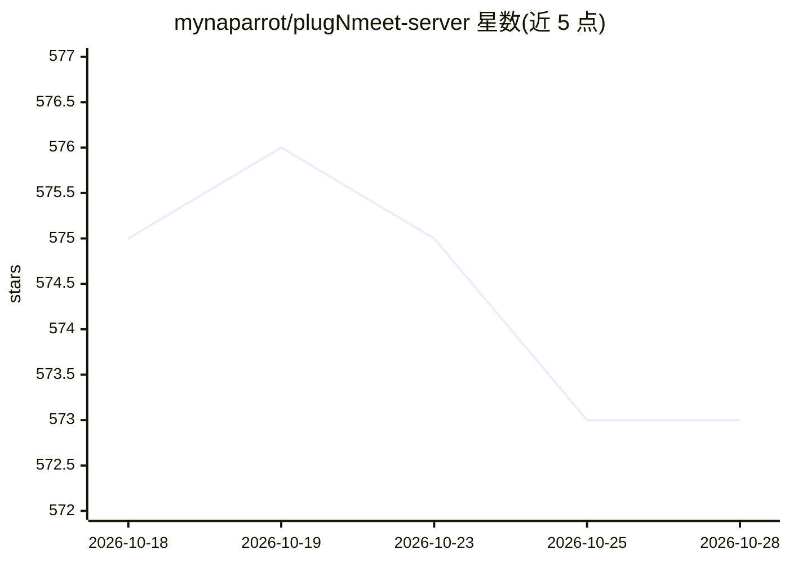

# mynaparrot/plugNmeet-server

⭐ 574 · Go · MIT · 推送 2026-10-28 · [GitHub](https://github.com/mynaparrot/plugNmeet-server) · [官网](https://www.plugnmeet.org) · 组织维护

**自托管视频会议软件，附 AI 会议转录/翻译/摘要**

基于 Go 与 LiveKit WebRTC 基础设施的自托管网络会议系统，提供 HD 音视频、屏幕共享、协作白板（支持 PDF/DOCX/PPTX）、投票、分组讨论室、MP4 录制、RTMP 推流与电话拨入（SIP）。AI 部分为会议代理：实时口译翻译、实时转录、自动摘要与行动项，经 Artifacts API 获取。通过 API 与 PHP/JavaScript SDK 集成，提供 WordPress/Moodle/Joomla 插件；手动部署需 LiveKit、Redis 与 MariaDB/MySQL。

## 筛选速览

| 维度 | 判定 | 备注 |
|---|---|---|
| AI 角色 | `ai-enhanced` | 去掉 AI 部分产品仍成立 |
| 许可风险 | `permissive` | MIT |
| 部署形态 | `self-host` | docker 或自建部署 |
| 模型依赖 | — | README 未给出锁定关系 |
| 硬件要求 | — | 无带数字的原话,不猜 |
| 安装摩擦 | `low` | 无编译、无系统依赖或容器化 |
| 成熟度 | — | 结构信号不足 |

## 能力要点

- Simulcast/Dynacast 自适应流，支持 H264/VP8/VP9/AV1
- AI 会议代理：实时翻译、转录、摘要与行动项（Artifacts API）
- 可选端到端加密（E2EE）覆盖媒体与数据通道
- 提供 PHP/JavaScript SDK 与 WordPress/Moodle/Joomla 插件

## 适用场景

- 在我的网站或系统内嵌入自托管视频会议
- 开视频会议时获得实时翻译、转录与自动摘要
- 录制会议并推流到 YouTube 或接入 OBS 制作流程

## 场景标签

`语音识别` · 领域:感知与多模态

## 证据(README 行号)

> L3: Plug-N-Meet is a powerful, open-source web conferencing solution built on the high-performance WebRTC infrastructure
> L15: * **AI-Powered Meeting Intelligence**: Turn meetings into actionable intelligence. The AI agent provides live spoke

## 星数曲线

2026-10-18 575 → 2026-10-28 573（-2）

---
*卡片 v1 · prompt 1.4 · 生成 2026-10-21 · 置信度 high · 依据 README sha `cde5e6667213` · [字段定义](../../DATASET.md)*
