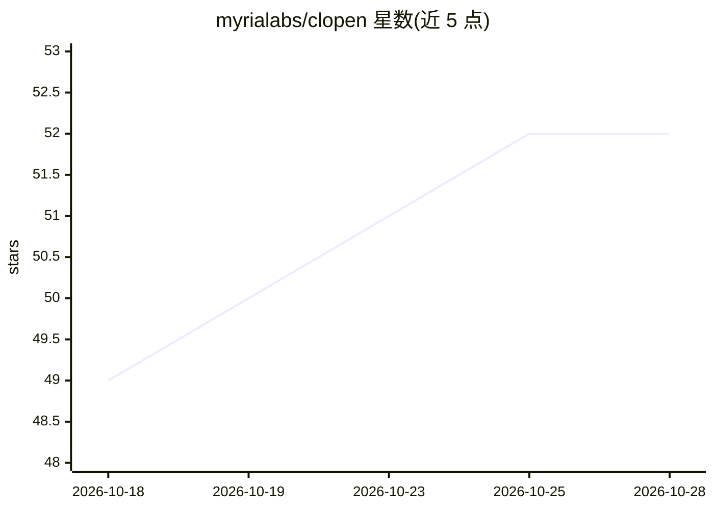

# myrialabs/clopen

⭐ 52 · TypeScript · MIT · 推送 2026-10-27 · [GitHub](https://github.com/myrialabs/clopen) · [官网](https://clopen.myrialabs.dev) · 组织维护

**多 AI 编码代理的统一工作区：聊天/终端/git/浏览器预览一体**

面向使用 AI 编码代理的开发者的自托管 Web 工作区：可在 Claude Code、OpenCode、Codex、Copilot、Qwen Code、Pi、Cline、Cursor 八种引擎间按会话切换，并为每个引擎管理多个账号。内置多标签终端、git 管理、Monaco 编辑器、实时浏览器预览（支持 AI 驱动交互）、连接 PostgreSQL/MySQL/SQLite/MongoDB/Redis 的数据库客户端、git 式检查点与实时协作。支持通过 MCP 注册表接入连接器，并跨引擎同步 Skills、Commands、Subagents。基于 Bun.js，用 bun add -g 安装后以 clopen 命令启动服务（默认 9141 端口）；AI 引擎均按需安装至 ~/.clopen/stack/engines 隔离目录，不捆绑在安装包内。

## 筛选速览

| 维度 | 判定 | 备注 |
|---|---|---|
| AI 角色 | `ai-ecosystem` | LLM/agent 周边工具 |
| 许可风险 | `permissive` | MIT |
| 部署形态 | `None` |  |
| 模型依赖 | — | README 未给出锁定关系 |
| 硬件要求 | — | 无带数字的原话,不猜 |
| 安装摩擦 | `low` | 无编译、无系统依赖或容器化 |
| 成熟度 | — | 结构信号不足 |

## 能力要点

- 8 种 AI 编码引擎按会话切换，每引擎可管理多账号
- git 式检查点：多分支撤销/重做，回滚不触及真实 git 历史
- 数据库客户端支持 PostgreSQL/MySQL/SQLite/MongoDB/Redis 及 SSH 隧道
- MCP 注册表浏览、OAuth/自定义头连接、按引擎控制工具暴露并跨引擎同步

## 适用场景

- 在同一界面里管理和切换多个 AI 编码代理与账号
- 团队在共享代码库上实时协作开发
- 在浏览器/移动设备上远程继续本地会话与终端进程

## 场景标签

`多智能体` `编码 Agent` · 领域:Agent 开发

## 证据(README 行号)

> L19: All-in-one workspace for AI coding agents — Claude Code, OpenCode, Codex, Copilot, Qwen Code, Pi, Cline, and Cursor
> L45: - **Multi-Engine Support** — Switch between Claude Code, OpenCode, Codex, GitHub Copilot, Qwen Code, Pi, Cline, and
> L59: - **Stack** — Install AI engines, Git, Chrome, and Cloudflared (for Public Tunnel) from a one-click admin panel. En

## 星数曲线

2026-10-18 49 → 2026-10-28 52（+3）

---
*卡片 v1 · prompt 1.4 · 生成 2026-10-24 · 置信度 high · 依据 README sha `5a962eb1f5d9` · [字段定义](../../DATASET.md)*
