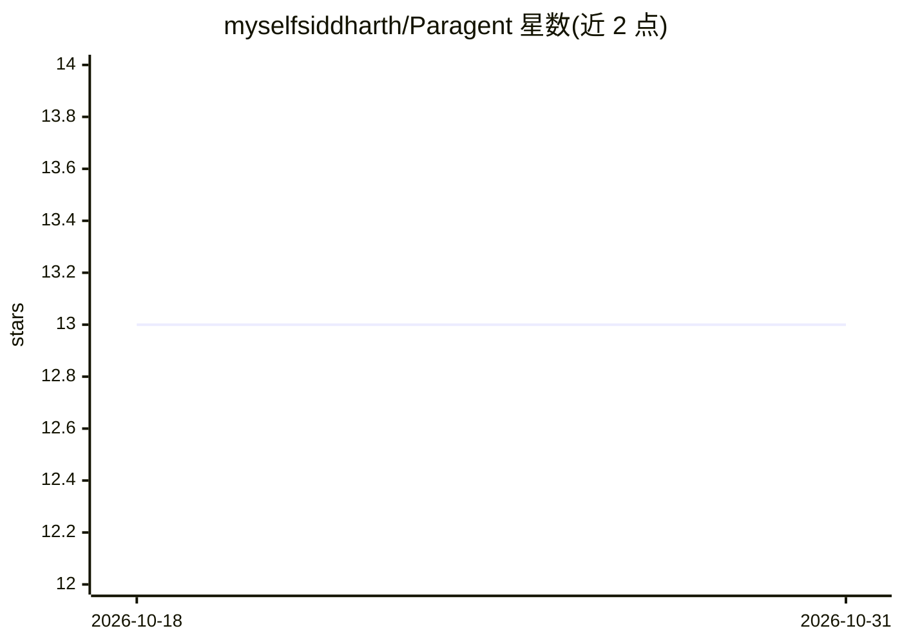

# myselfsiddharth/Paragent

⭐ 13 · TypeScript · MIT · 推送 2026-10-26 · [GitHub](https://github.com/myselfsiddharth/Paragent) · [官网](https://www.npmjs.com/package/paragent) · 个人维护

**浏览器任务的录制-回放执行层：回放无需模型，失败时模型修复**

面向浏览器自动化的有状态执行层：开发者手工完成一次任务并记录轨迹，编译为带逐步后置断言的确定性回放脚本，回放时模型不在环中；断言失败时才调用模型修复该步并写回脚本。默认修复客户端为 Stub（不产出修复），可选 Anthropic 客户端（需 API key）或委托客户端（由调用方自带模型，无需第二份账单）。当前处于早期阶段：录制为开发者手写轨迹（CLI），录制任意 agent 的路径尚未构建（#127），README 自述核心论点未验证、无性能基准。以 npm 包提供 CLI，内含可离线运行的浏览器 fixture。

## 筛选速览

| 维度 | 判定 | 备注 |
|---|---|---|
| AI 角色 | `ai-ecosystem` | LLM/agent 周边工具 |
| 许可风险 | `permissive` | MIT |
| 部署形态 | `library` | 以包/库形式分发 |
| 模型依赖 | — | README 未给出锁定关系 |
| 硬件要求 | — | 无带数字的原话,不猜 |
| 安装摩擦 | `low` | 无编译、无系统依赖或容器化 |
| 成熟度 | `idea` | |

## 能力要点

- 逐步后置断言的确定性回放，模型不在环中
- 断言失败时才调用模型修复单步并写回脚本
- DelegatedRepairModelClient 可复用调用方自有模型，无需 ANTHROPIC_API_KEY
- 包内置浏览器 fixture，除浏览器二进制下载外可离线运行

## 适用场景

- 重复执行的浏览器任务替代每次重新规划的 agent 运行
- 在无干净 API、只能走 UI 的场景中固化操作流程
- 页面变更后定位并修复失败的具体步骤

## 场景标签

`浏览器自动化` · 领域:效率与自动化

## 证据(README 行号)

> L14: Paragent takes the model out of the second run. It records a developer's **successful** trajectory
> L113: Most browser-agent frameworks optimise the *first* run — better planning, better DOM
> L114: grounding, better recovery. Paragent is meant to compose with them rather than replace them:

## 星数曲线

2026-10-18 13 → 2026-10-31 13（+0）

---
*卡片 v1 · prompt 1.4 · 生成 2026-10-31 · 置信度 high · 依据 README sha `794f353b2fbf` · [字段定义](../../DATASET.md)*
