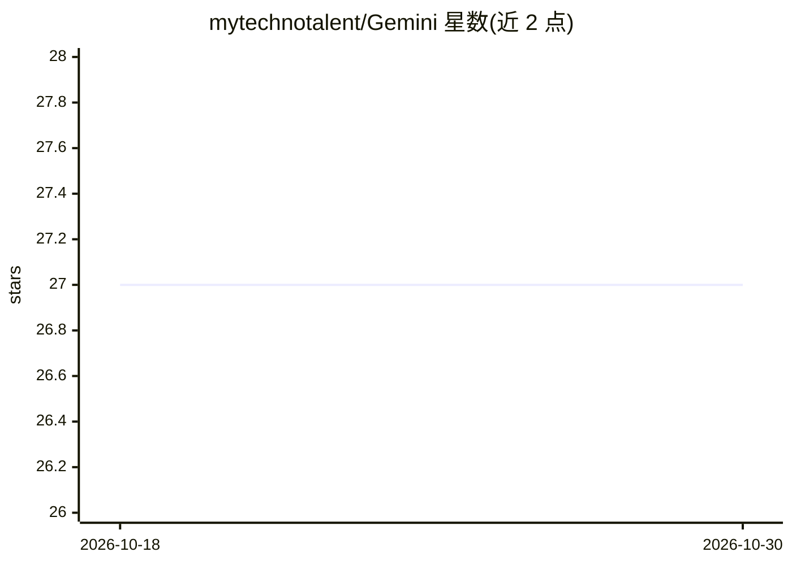

# mytechnotalent/Gemini

⭐ 27 · Python · MIT · 推送 2025-11-26 · [GitHub](https://github.com/mytechnotalent/Gemini) · 个人维护

**调用 Google Gemini API 的语音识别与语音交互 Python 脚本**

单文件 Python 脚本项目：通过环境变量配置 Google Gemini API key，结合 ffmpeg 处理音频，实现语音识别与语音输出能力。README 仅提供 Linux/MAC 与 Windows 两平台的 venv 环境搭建、依赖安装（pip install -r requirements.txt）与运行命令（python gemini.py），并展示 gemini.py 的部分源码。需用户自行申请 API key 并安装 ffmpeg。信息量有限，无功能细节或示例输出说明。

## 筛选速览

| 维度 | 判定 | 备注 |
|---|---|---|
| AI 角色 | `ai-native` | 本体是模型或模型工具 |
| 许可风险 | `permissive` | MIT |
| 部署形态 | `library` | 以包/库形式分发 |
| 模型依赖 | — | README 未给出锁定关系 |
| 硬件要求 | — | 无带数字的原话,不猜 |
| 安装摩擦 | `medium` | 含编译或系统依赖之一 |
| 成熟度 | — | 结构信号不足 |

## 能力要点

- 通过 GOOGLE_GEMINI_API_KEY 环境变量接入 Google Gemini API
- 支持语音识别与语音输出（依赖 ffmpeg）
- 提供 Linux/MAC 与 Windows 两平台的环境搭建步骤

## 适用场景

- 快速体验 Gemini API 的语音识别与语音功能
- 作为接入 Google Gemini 的最小可运行示例代码

## 场景标签

`语音识别` `语音合成` · 领域:内容生成

## 证据(README 行号)

> L4: Google Gemini AI model w/speech recognition and voice.
> L32: python gemini.py

## 星数曲线

2026-10-18 27 → 2026-10-30 27（+0）

---
*卡片 v1 · prompt 1.4 · 生成 2026-10-26 · 置信度 mid · 依据 README sha `1229b0f2d9c6` · [字段定义](../../DATASET.md)*
