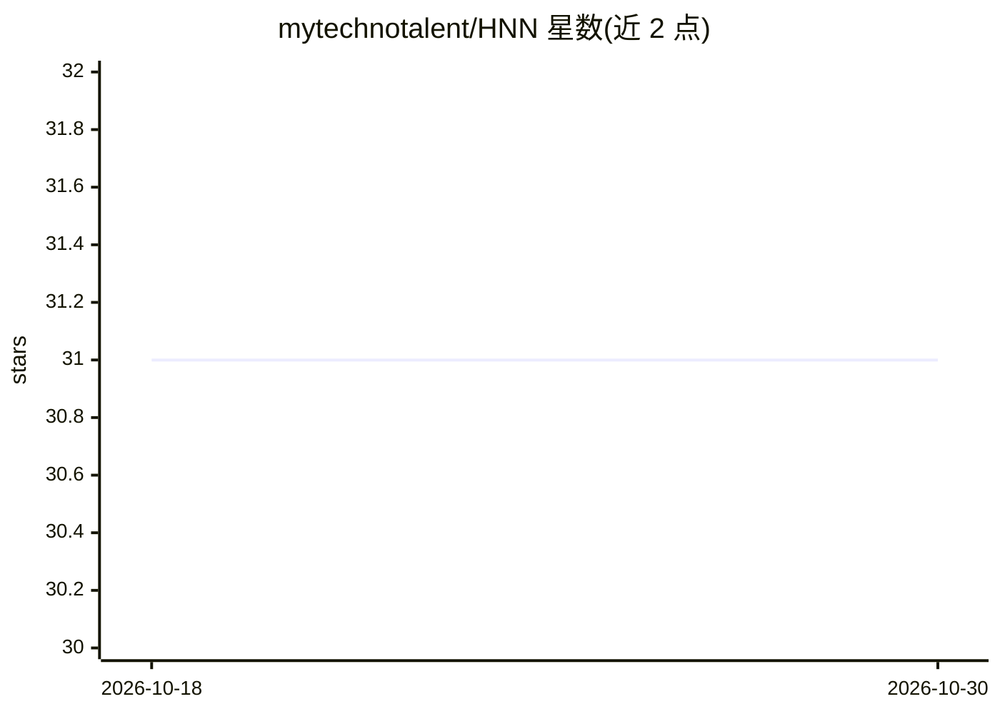

# mytechnotalent/HNN

⭐ 31 · Jupyter Notebook · Apache-2.0 · 推送 2025-11-26 · [GitHub](https://github.com/mytechnotalent/HNN) · 个人维护

**神经网络内部计算的逐步教学 notebook，面向学习者**

由 Kevin Thomas 编写的 Jupyter notebook 教程《Hacking Neural Networks》，逐步拆解一个最简神经网络的内部计算：用 PyTorch 定义两个输入、两个权重、一个偏置与 tanh 激活，跑 10 个 epoch，每轮展示前向传播、反向传播梯度推导（含 dL/dw1、dL/dw2、dL/db 公式）与梯度下降参数更新的具体数值。面向学习神经网络原理的学生与开发者，形式为单个可运行 notebook，依赖通过 pip install torch 安装。

## 筛选速览

| 维度 | 判定 | 备注 |
|---|---|---|
| AI 角色 | `ai-knowledge` | 知识聚合/清单类 |
| 许可风险 | `permissive` | Apache-2.0 |
| 部署形态 | `library` | 以包/库形式分发 |
| 模型依赖 | — | README 未给出锁定关系 |
| 硬件要求 | — | 无带数字的原话,不猜 |
| 安装摩擦 | `low` | 无编译、无系统依赖或容器化 |
| 成熟度 | — | 结构信号不足 |

## 能力要点

- 逐 epoch 展示前向传播/反向传播/梯度下降三个步骤的数值
- 给出各参数梯度的解析公式（如 dL/dw1 = x1 * (o - target) * (1 - o^2)）
- 基于 PyTorch 自动微分（requires_grad）实现
- 网络规模极简：2 输入、2 权重、1 偏置、tanh 激活

## 适用场景

- 逐步理解前向传播与反向传播的数值过程
- 验证手推梯度公式与 PyTorch 自动微分结果的一致性
- 作为神经网络入门的动手练习材料

## 场景标签

`教程课程` · 领域:学习与行业

## 证据(README 行号)

> L15: Welcome to the **Hacking Neural Networks** notebook! This notebook is designed to provide a detailed, step-by-step 
> L19: The focus of this repository is to make neural networks accessible and hackable. We emphasize **hands-on exploratio

## 星数曲线

2026-10-18 31 → 2026-10-30 31（+0）

---
*卡片 v1 · prompt 1.4 · 生成 2026-10-26 · 置信度 mid · 依据 README sha `8f612835db87` · [字段定义](../../DATASET.md)*
