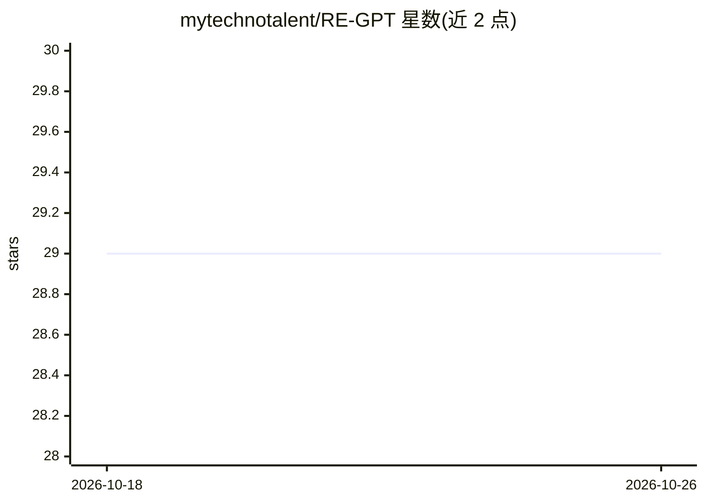

# mytechnotalent/RE-GPT

⭐ 29 · Jupyter Notebook · Apache-2.0 · 推送 2025-12-12 · [GitHub](https://github.com/mytechnotalent/RE-GPT) · 个人维护

**逐步从零构建 GPT 的教学代码讲解（仿 Karpathy）**

受 Andrej Karpathy 的 "Let's Build GPT" 启发的教学项目，以 notebook 形式带读者从零实现 GPT：讲解并编码 self-attention 的 query/key/value 机制、注意力掩码（decoder block）、缩放点积注意力中除以 √dk 的方差归一化，以及 softmax 对注意力分布的影响，配合 Attention Is All You Need 论文图示。由 Kevin Thomas 讲授，依赖 PyTorch，面向学习 Transformer 内部原理的开发者与学习者。

## 筛选速览

| 维度 | 判定 | 备注 |
|---|---|---|
| AI 角色 | `ai-knowledge` | 知识聚合/清单类 |
| 许可风险 | `permissive` | Apache-2.0 |
| 部署形态 | `library` | 以包/库形式分发 |
| 模型依赖 | — | README 未给出锁定关系 |
| 硬件要求 | — | 无带数字的原话,不猜 |
| 安装摩擦 | `low` | 无编译、无系统依赖或容器化 |
| 成熟度 | — | 结构信号不足 |

## 能力要点

- 逐步讲解并实现 self-attention（query/key/value 与亲和度计算）
- 解释 decoder 掩码与位置编码的作用
- 演示缩放注意力 head_size**-0.5 的方差归一化及其数值验证
- 引用 Attention Is All You Need 论文作为理论依据

## 适用场景

- 想理解 GPT/Transformer 内部机制的学习者跟练
- 课堂教学或自学 Transformer 注意力原理的代码材料
- 配合 Karpathy 原视频做实践补充

## 场景标签

`教程课程` · 领域:学习与行业

## 证据(README 行号)

> L13: #### Inspired by Andrej Karpathy’s "Let’s Build GPT", this project guides you step‑by‑step to build a GPT from scra
> L20: ## Attention Is All You Need

## 星数曲线

2026-10-18 29 → 2026-10-26 29（+0）

---
*卡片 v1 · prompt 1.4 · 生成 2026-10-26 · 置信度 mid · 依据 README sha `2d938120e7cd` · [字段定义](../../DATASET.md)*
