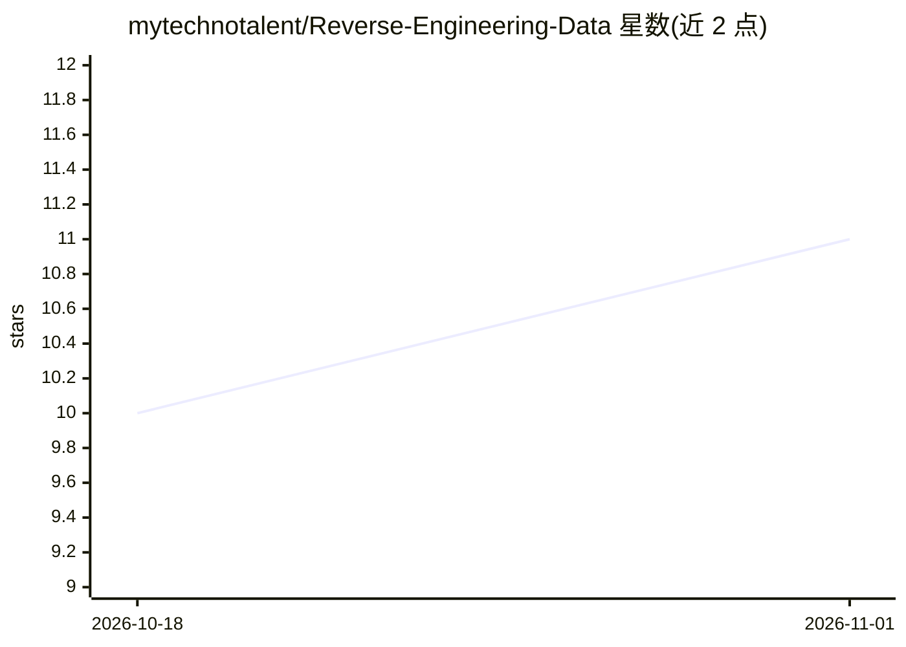

# mytechnotalent/Reverse-Engineering-Data

⭐ 11 · Jupyter Notebook · Apache-2.0 · 推送 2026-09-27 · [GitHub](https://github.com/mytechnotalent/Reverse-Engineering-Data) · 个人维护

**逆向工程数据自学课程：30 章 Jupyter 教程与配套教科书**

由 mytechnotalent 维护的数据科学与逆向工程自学教程仓库：以 30 个编号 Jupyter 笔记本（00-29）为载体，覆盖统计基础（中心极限定理、置信区间）、EDA、聚类与 PCA、线性/逻辑回归、PyTorch 实现的 MLP/CNN/RNN/Transformer、从零构建 TinyGPT、自编码器、GAN、U-Net 分割、DQN 强化学习、LLM 微调与 ONNX 部署等主题。附完整课程 PDF 教科书、数据集（CSV、Tiny Shakespeare、Fashion-MNIST 等）、训练好的模型工件与 Kaggle 提交输出。通过 Conda 环境运行，采用 Apache-2.0 许可证。

## 筛选速览

| 维度 | 判定 | 备注 |
|---|---|---|
| AI 角色 | `ai-knowledge` | 知识聚合/清单类 |
| 许可风险 | `permissive` | Apache-2.0 |
| 部署形态 | `None` |  |
| 模型依赖 | — | README 未给出锁定关系 |
| 硬件要求 | — | 无带数字的原话,不猜 |
| 安装摩擦 | `low` | 无编译、无系统依赖或容器化 |
| 成熟度 | — | 结构信号不足 |

## 能力要点

- 30 个编号 Jupyter 笔记本覆盖统计、经典 ML 到深度学习与 LLM 微调
- 从零构建 Transformer 块与 TinyGPT
- 包含 ONNX 模型部署与命令行界面章节
- 提供完整课程 PDF 教科书与配套数据集、模型工件

## 适用场景

- 按章节系统自学数据科学与逆向分析数据集
- 参考从零实现 GPT、GAN、ViT、U-Net 等模型的代码
- 作为 PyTorch 与统计学习的教学材料

## 场景标签

`教程课程` · 领域:学习与行业

## 证据(README 行号)

> L22: *.ipynb    the 30 notebooks, numbered 00 through 29
> L30: ### Chapter 1: Central Limit Theorem

## 星数曲线

2026-10-18 10 → 2026-11-01 11（+1）

---
*卡片 v1 · prompt 1.4 · 生成 2026-11-01 · 置信度 high · 依据 README sha `117be3579ffd` · [字段定义](../../DATASET.md)*
