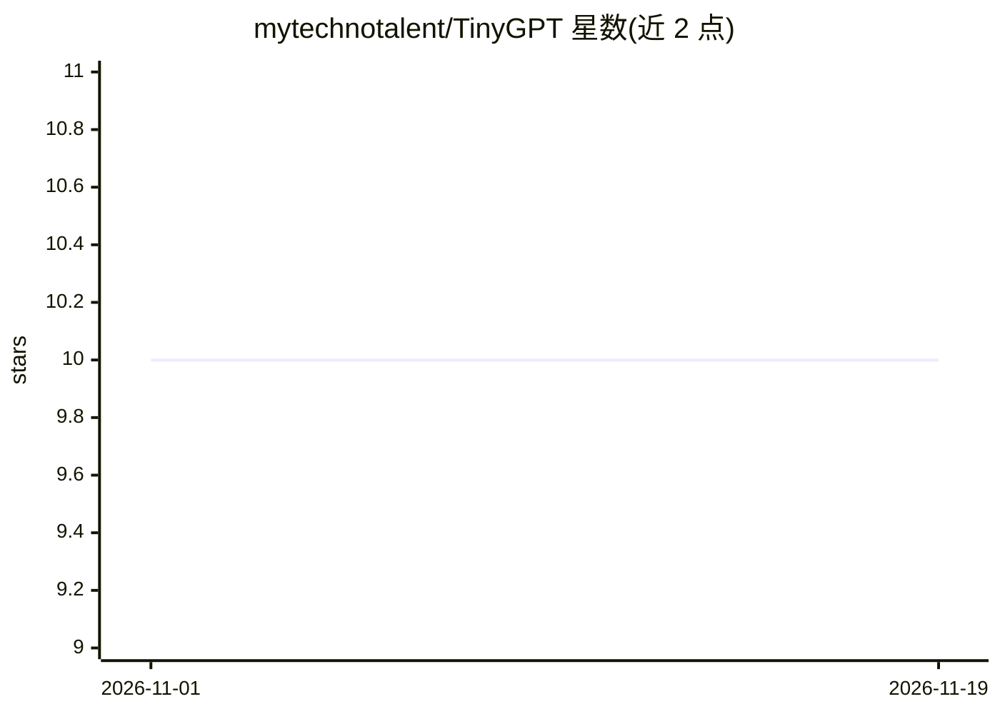

# mytechnotalent/TinyGPT

⭐ 10 · Rust · MIT · 推送 2026-10-10 · [GitHub](https://github.com/mytechnotalent/TinyGPT) · 个人维护

**开发者：用纯 Rust 从零实现 GPT 的教学项目**

以 Rust 编写的迷你 GPT 实现，仅依赖 ndarray 做张量运算，不使用深度学习框架。按模块讲解嵌入、多头注意力、层归一化、前馈网络、残差块、自回归生成与反向传播的实现细节，词级分词，训练语料为 50 句逆向工程句子，训练后生成示例文本。面向想理解 transformer 内部机制的读者，附带 123 个单元测试（95.30% 覆盖率）与 Tarpaulin 覆盖率流程。

## 筛选速览

| 维度 | 判定 | 备注 |
|---|---|---|
| AI 角色 | `ai-native` | 本体是模型或模型工具 |
| 许可风险 | `permissive` | MIT |
| 部署形态 | `library` | 以包/库形式分发 |
| 模型依赖 | — | README 未给出锁定关系 |
| 硬件要求 | — | 无带数字的原话,不猜 |
| 安装摩擦 | `medium` | 含编译或系统依赖之一 |
| 成熟度 | — | 结构信号不足 |

## 能力要点

- 仅用 ndarray 从零实现注意力、反向传播与自回归生成
- 13 个模块逐一讲解组件原理与对应代码
- 123 个单元测试，覆盖率 95.30%
- JSON 配置文件管理超参数，编译期加载

## 适用场景

- 逐模块学习 transformer 的底层实现原理
- 在不依赖深度学习框架的前提下研究注意力与反向传播数学
- 作为 Rust 神经网络实现的参考代码库

## 场景标签

`教程课程` · 领域:学习与行业

## 证据(README 行号)

> L8: A comprehensive tutorial implementation of a GPT (Generative Pre-trained Transformer) language model written entirel
> L13: This project implements a miniature version of the GPT architecture, the same fundamental design behind models like
> L150: The `generate` method implements autoregressive generation:

## 星数曲线

2026-11-01 10 → 2026-11-19 10（+0）

---
*卡片 v1 · prompt 1.4 · 生成 2026-11-19 · 置信度 high · 依据 README sha `e39d575791ac` · [字段定义](../../DATASET.md)*
