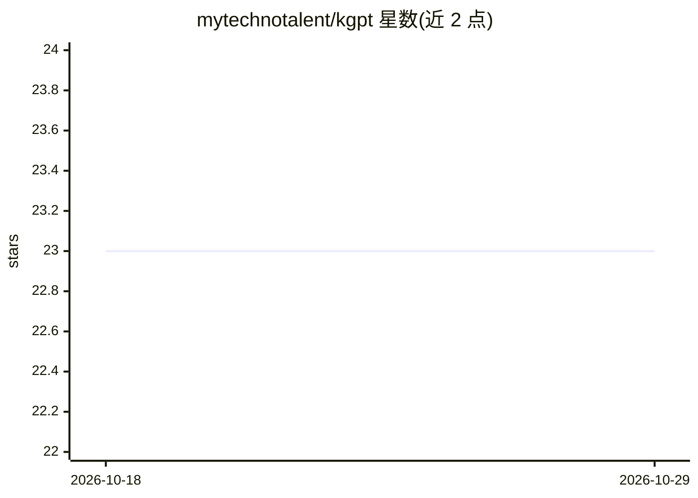

# mytechnotalent/kgpt

⭐ 23 · Jupyter Notebook · Apache-2.0 · 推送 2026-03-04 · [GitHub](https://github.com/mytechnotalent/kgpt) · 个人维护

**从零复现 GPT-2 架构的教育向语言模型与聊天机器人**

基于 Zero To Hero 课程路线、用 tiktoken 在 OpenWebText 上从零预训练的 GPT-2 小型架构实现（124M 参数，n_embd=768、12 层 12 头）。提供完整训练管线：prepare_data.py 下载约 54GB 语料并 tokenize、train.py 预训练（DDP + torch.compile）、finetune.py 在 1 万条对话数据上微调、inference.py 启动带温度/top-k 采样的交互式聊天机器人。附可在 Kaggle T4 GPU 单会话内跑通全流程的 notebook，面向 Transformer 模型教学与逆向工程学习者。

## 筛选速览

| 维度 | 判定 | 备注 |
|---|---|---|
| AI 角色 | `ai-native` | 本体是模型或模型工具 |
| 许可风险 | `permissive` | Apache-2.0 |
| 部署形态 | `library` | 以包/库形式分发 |
| 模型依赖 | — | README 未给出锁定关系 |
| 硬件要求 | — | 无带数字的原话,不猜 |
| 安装摩擦 | `medium` | 含编译或系统依赖之一 |
| 成熟度 | — | 结构信号不足 |

## 能力要点

- GPT-2 small 同构架构：124M 参数、weight tying、fused CausalSelfAttention、DDP、torch.compile
- 全流程脚本：数据准备→预训练→对话微调→交互式推理
- 自动设备选择 cuda > mps > cpu，支持 fp16 混合精度
- kgpt-lite.ipynb 在 Kaggle T4 上约 8-9 小时单会话完成训练与推理

## 适用场景

- 学习 GPT/Transformer 模型的从零实现与训练流程
- 复现并微调一个小型对话模型用于教学实验
- 在免费 Kaggle GPU 上完整体验预训练到聊天推理流程

## 场景标签

`教程课程` `模型训练` `微调` · 领域:学习与行业

## 证据(README 行号)

> L6: A GPT-2-class language model trained from scratch on OpenWebText based on Zero To Hero utilizing tiktoken with the i
> L8: The model matches the nanoGPT / GPT-2 small architecture (`n_embd=768`, `n_head=12`, `n_layer=12`, `block_size=1024`
> L76: python inference.py

## 星数曲线

2026-10-18 23 → 2026-10-29 23（+0）

---
*卡片 v1 · prompt 1.4 · 生成 2026-10-27 · 置信度 high · 依据 README sha `8977dc4e96ea` · [字段定义](../../DATASET.md)*
