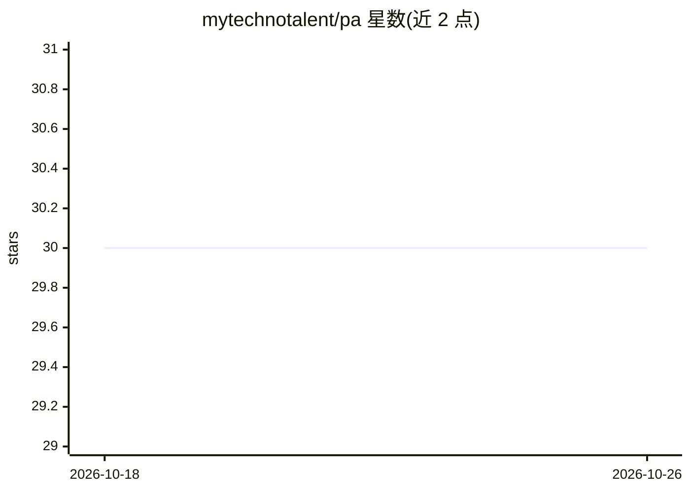

# mytechnotalent/pa

⭐ 30 · Jupyter Notebook · Apache-2.0 · 推送 2025-11-26 · [GitHub](https://github.com/mytechnotalent/pa) · 个人维护

**基于 RAG 的个人 PDF 文档问答助手（Groq LLaMA-3.1）**

以 Jupyter Notebook 流程实现的个人助理：读取目录中的单个 PDF，经 SentenceSplitter 切块，用 sentence-transformers/all-MiniLM-L6-v2 生成嵌入并构建 VectorStoreIndex，索引持久化后经查询引擎回答用户问题；LLM 通过 Groq API 调用 llama-3.1-8b-instant，需用户自行申请 GROQ_API_KEY。安装依赖 Conda（Python 3.11、PyTorch 等）与 Tesseract，OCR 转换环节需借助外部网站 ilovepdf 完成，最终以 Gradio 界面在本地 7860 端口运行。

## 筛选速览

| 维度 | 判定 | 备注 |
|---|---|---|
| AI 角色 | `ai-native` | 本体是模型或模型工具 |
| 许可风险 | `permissive` | Apache-2.0 |
| 部署形态 | `None` |  |
| 模型依赖 | locked-api |  |
| 硬件要求 | — | 无带数字的原话,不猜 |
| 安装摩擦 | `low` | 无编译、无系统依赖或容器化 |
| 成熟度 | — | 结构信号不足 |

## 能力要点

- PDF 加载→切块→嵌入→VectorStoreIndex 持久化的 RAG 流程
- Groq API 调用 llama-3.1-8b-instant 模型
- sentence-transformers/all-MiniLM-L6-v2 嵌入模型
- Gradio 本地界面运行于 127.0.0.1:7860

## 适用场景

- 对本地 PDF 文档进行检索式问答
- 学习 RAG 架构的端到端实现流程
- 搭建个人文档知识库问答界面

## 场景标签

`文档问答` `教程课程` · 领域:知识与检索

## 证据(README 行号)

> L6: A Personal Assistant leveraging Retrieval-Augmented Generation (RAG) and the LLaMA-3.1-8B-Instant Large Language Mod
> L138: llm = Groq(model="llama-3.1-8b-instant", api_key=GROQ_API_KEY)
> L180: query_engine = index.as_query_engine()

## 星数曲线

2026-10-18 30 → 2026-10-26 30（+0）

---
*卡片 v1 · prompt 1.4 · 生成 2026-10-26 · 置信度 high · 依据 README sha `c802afdb6839` · [字段定义](../../DATASET.md)*
