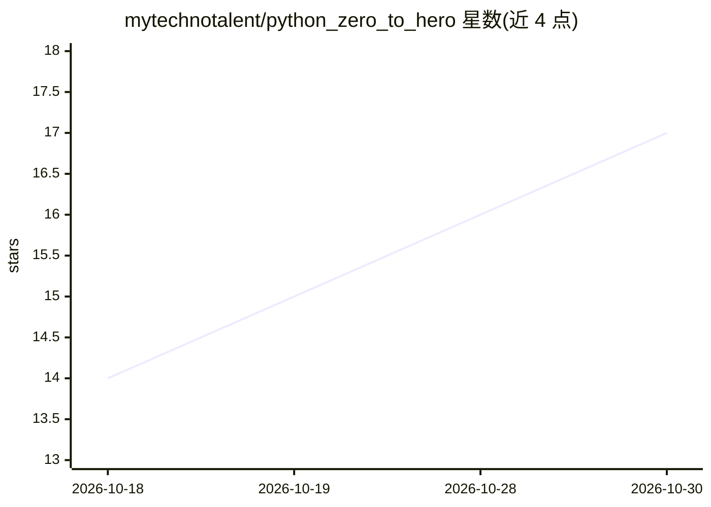

# mytechnotalent/python_zero_to_hero

⭐ 17 · Jupyter Notebook · MIT · 推送 2026-01-19 · [GitHub](https://github.com/mytechnotalent/python_zero_to_hero) · 个人维护

**面向初学者的 Python 与神经网络入门教程（含 PyTorch 与 GPT）**

以教学笔记本形式组织的 Python 教程：覆盖基础语法、数据结构、函数与类，随后用 NumPy 从零实现并训练解决 XOR 问题的两层神经网络，再进入 PyTorch 回归、PyTorch 分类与从零构建 GPT 语言模型的章节。面向初学者，代码附完整解释与 docstrings，依赖通过 %pip install 安装 numpy/pandas/matplotlib/torch/scikit-learn。教程以代码单元加运行输出的形式呈现，非可安装的软件产品。

## 筛选速览

| 维度 | 判定 | 备注 |
|---|---|---|
| AI 角色 | `ai-knowledge` | 知识聚合/清单类 |
| 许可风险 | `permissive` | MIT |
| 部署形态 | `library` | 以包/库形式分发 |
| 模型依赖 | — | README 未给出锁定关系 |
| 硬件要求 | — | 无带数字的原话,不猜 |
| 安装摩擦 | `low` | 无编译、无系统依赖或容器化 |
| 成熟度 | — | 结构信号不足 |

## 能力要点

- NumPy 从零实现前向传播、反向传播与梯度下降并训练 XOR 网络
- PyTorch 回归与分类章节（连续值与类别预测）
- GPT from Scratch 章节，从零构建语言模型
- 全部代码附完整解释与 docstrings

## 适用场景

- 零基础学习 Python 语法、数据结构与面向对象
- 理解神经网络前向/反向传播的训练过程
- 通过 PyTorch 入门回归与分类任务

## 场景标签

`教程课程` · 领域:学习与行业

## 证据(README 行号)

> L3: ## A comprehensive tutorial covering:
> L12: Written for beginners, with full explanations and docstrings!

## 星数曲线

2026-10-18 14 → 2026-10-30 17（+3）

---
*卡片 v1 · prompt 1.4 · 生成 2026-10-30 · 置信度 mid · 依据 README sha `25341aea2e30` · [字段定义](../../DATASET.md)*
