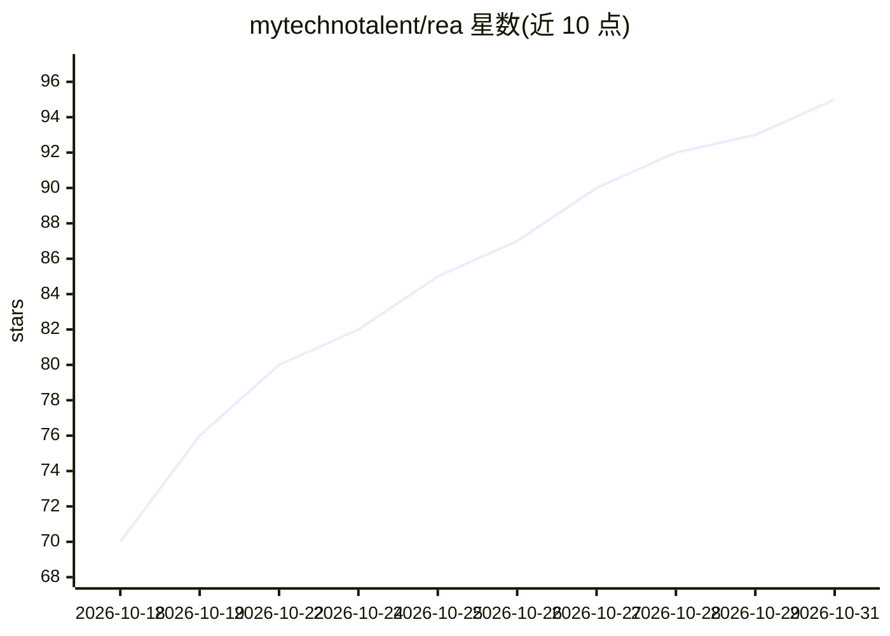

# mytechnotalent/rea

⭐ 95 · Rust · MIT · 推送 2026-10-21 · [GitHub](https://github.com/mytechnotalent/rea) · 个人维护

**纯 Rust 逆向工程框架：一条命令生成二进制分析报告**

面向安全研究者的逆向工程工具：用 `rea <file>` 一条命令在目标旁生成 Markdown、PDF 与 JSON 三份报告，覆盖 PE/ELF/Mach-O、固件、APK、.NET、WebAssembly、GGUF 模型文件等约 30 种格式的解析与静态分析，含 SBOM、反汇编、P-Code 沙箱模拟、解密与 IoC 提取。配置 OpenRouter API key 后可运行 90 轮自主工具调用的 AI 分析师循环；无 key 时完全离线确定性运行。另提供 MCP 服务器（stdio JSON-RPC，31 个工具）供 AI 编码 agent 调用。100% Rust 实现，`#![forbid(unsafe_code)]`，无外部工具依赖。

## 筛选速览

| 维度 | 判定 | 备注 |
|---|---|---|
| AI 角色 | `ai-enhanced` | 去掉 AI 部分产品仍成立 |
| 许可风险 | `permissive` | MIT |
| 部署形态 | `desktop` | 安装包/桌面程序 |
| 模型依赖 | — | README 未给出锁定关系 |
| 硬件要求 | — | 无带数字的原话,不猜 |
| 安装摩擦 | `medium` | 含编译或系统依赖之一 |
| 成熟度 | — | 结构信号不足 |

## 能力要点

- 一条命令生成 Markdown/PDF/JSON 三格式逆向报告，约 30 种目标格式
- 自主 AI 安全评估：90 轮工具调用分析循环，带 grounding 校验
- 无 API key 时完全离线确定性运行，零网络请求
- MCP 服务器暴露 31 个工具供 Claude Code / OpenCode 等 agent 调用

## 适用场景

- 分析可疑二进制与固件并生成可交付的分析报告
- 对二进制做 SBOM（CycloneDX/SPDX）与供应链溯源
- 让 AI 编码 agent 通过 MCP 交互式驱动逆向分析
- 离线环境（无网络、无 API key）下做静态逆向

## 场景标签

`网络安全` · 领域:学习与行业

## 证据(README 行号)

> L29: - **Autonomous AI Security Assessment.** When configured with an API key, REA runs an autonomous, 90-turn tool-call
> L30: - **Deterministic Offline Fallback.** With no AI API key, REA runs completely offline, generating comprehensive det
> L115: The MCP server exposes the same engine as tools so AI coding agents can drive the analysis interactively. It runs 

## 星数曲线

2026-10-18 70 → 2026-10-31 95（+25）

---
*卡片 v1 · prompt 1.4 · 生成 2026-10-24 · 置信度 high · 依据 README sha `dd3177d15cbc` · [字段定义](../../DATASET.md)*
