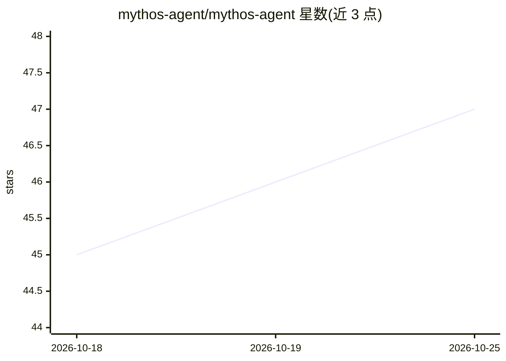

# mythos-agent/mythos-agent

⭐ 47 · TypeScript · MIT · 推送 2026-05-23 · [GitHub](https://github.com/mythos-agent/mythos-agent) · [官网](https://mythos-agent.com) · 组织维护 · 中文 README

**面向开发者的 AI 代码安全审查工具，检测漏洞并生成修复**

开源的 CLI 代码安全审查助手：读取代码库后运行多智能体管线（Recon→Hypothesis→Analyze→Exploit），结合 15 个已接入扫描器与 329+ 规则，覆盖代码模式、密钥、依赖 CVE、IaC、AI/LLM 安全、OWASP API Top 10 等类别；支持基于已知 CVE 的变体分析、AI 生成补丁、污点分析、DAST 智能模糊测试与 SARIF 报告输出。AI 提供方分三层：Anthropic 为主力，OpenAI 兼容端与本地 Ollama/vLLM/LM Studio 走代理通道。模式扫描、密钥、依赖与 IaC 检查无需 API key。npm 全局安装，提供 VS Code 扩展、GitHub Action 与 PR 审查机器人集成。

## 筛选速览

| 维度 | 判定 | 备注 |
|---|---|---|
| AI 角色 | `ai-enhanced` | 去掉 AI 部分产品仍成立 |
| 许可风险 | `permissive` | MIT |
| 部署形态 | `library` | 以包/库形式分发 |
| 模型依赖 | local-ok | 支持本地模型 |
| 硬件要求 | — | 无带数字的原话,不猜 |
| 安装摩擦 | `low` | 无编译、无系统依赖或容器化 |
| 成熟度 | — | 结构信号不足 |

## 能力要点

- 多智能体管线：Recon→Hypothesis→Analyze→Exploit，多阶段验证后才报告为 confirmed
- 变体分析：从已知 CVE 提取根因模式，检索结构相似代码
- 15 个已接入 + 28 个实验性扫描器，329+ 规则
- AI 提供方三层体系：Anthropic / OpenAI 兼容代理 / 本地 Ollama·vLLM·LM Studio

## 适用场景

- 在编码或 PR 阶段扫描代码中的安全漏洞并获取 AI 修复建议
- 检查代码库中是否存在与已知 CVE 根因相似的变体
- 导出 SARIF 报告接入 GitHub Code Scanning 等平台

## 场景标签

`代码审查` `网络安全` · 领域:编码与开发

## 证据(README 行号)

> L8:  AI code-review assistant for application security.
> L179: Pattern scanning, secrets, deps, and IaC work without any API key.

## 星数曲线

2026-10-18 45 → 2026-10-25 47（+2）

---
*卡片 v1 · prompt 1.4 · 生成 2026-10-25 · 置信度 high · 依据 README sha `ed5145ab0148` · [字段定义](../../DATASET.md)*
