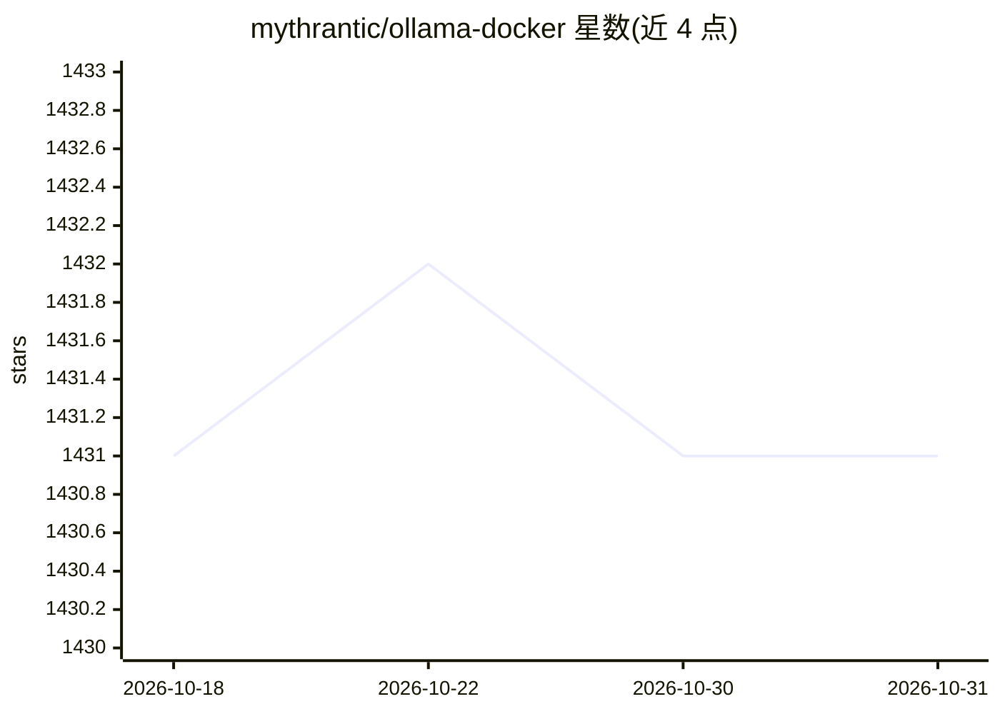

# mythrantic/ollama-docker

⭐ 1,431 · HTML · NOASSERTION · 推送 2026-05-26 · [GitHub](https://github.com/mythrantic/ollama-docker) · [官网](https://ollama-docker.valiantlynx.com/) · 个人维护

**用 Docker Compose 一键部署 Ollama 及其 WebUI 的脚手架**

提供 Ollama 的 Docker Compose 部署配置：含 CPU 与 GPU（NVIDIA Container Toolkit）两套 compose 文件，附带 Ollama-webui（localhost:8080）和一个名为 app 的实验容器，内含 LangChain 与 Ollama 的示例代码，可作 devcontainer 或以 run.sh 建虚拟环境使用。使用方式为 git clone 后执行 docker compose up -d，在 WebUI 设置页安装模型（如 llava-phi3）。

## 筛选速览

| 维度 | 判定 | 备注 |
|---|---|---|
| AI 角色 | `ai-ecosystem` | LLM/agent 周边工具 |
| 许可风险 | `none` | NOASSERTION |
| 部署形态 | `self-host` | docker 或自建部署 |
| 模型依赖 | local-ok | 支持本地模型 |
| 硬件要求 | — | 无带数字的原话,不猜 |
| 安装摩擦 | `low` | 无编译、无系统依赖或容器化 |
| 成熟度 | — | 结构信号不足 |

## 能力要点

- CPU/GPU 双版本 Compose 文件部署 Ollama
- 附带 Ollama-webui（localhost:8080）图形界面装模型
- app 容器内置 LangChain+Ollama 示例，兼作 devcontainer
- run.sh 提供不用 Docker 的虚拟环境搭建路径

## 适用场景

- 本地快速拉起 Ollama 与 WebUI 环境
- 在容器里实验 LangChain 与 Ollama 的组合
- 为带 GPU 的机器配置容器化模型推理环境

## 场景标签

 · 领域:LLM 基础设施/部署

## 证据(README 行号)

> L5: Welcome to the Ollama Docker Compose Setup! This project simplifies the deployment of Ollama using Docker Compose, m
> L42: Start Ollama and its dependencies using Docker Compose:

## 星数曲线

2026-10-18 1,431 → 2026-10-31 1,431（+0）

---
*卡片 v1 · prompt 1.4 · 生成 2026-10-21 · 置信度 high · 依据 README sha `8c339da35ec2` · [字段定义](../../DATASET.md)*
