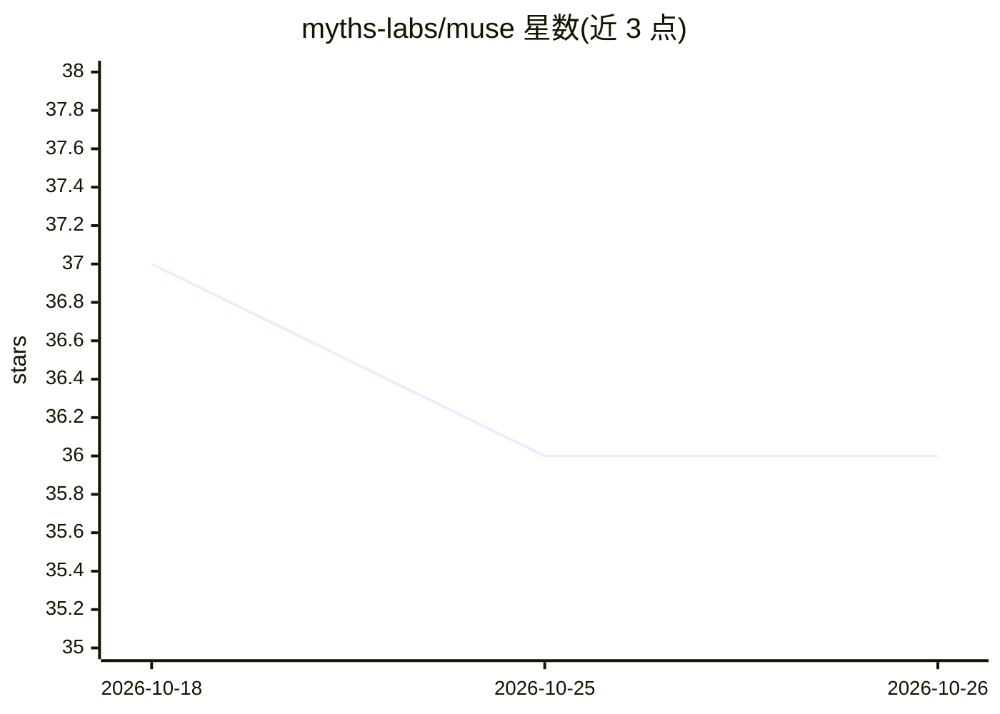

# myths-labs/muse

⭐ 36 · Python · MIT · 推送 2026-10-24 · [GitHub](https://github.com/myths-labs/muse) · [官网](https://github.com/myths-labs/muse) · 组织维护 · 中文 README

**面向 AI 结对编程的 Markdown 治理系统：角色、记忆与技能管理**

以纯 Markdown 加 Python 运行时构成的 AI 编程治理系统，为 AI 编码助手提供角色隔离、双层持久记忆（memory/ 短期 + MEMORIES.md 长期）、67 个技能、跨角色指令队列与可视化仪表盘。通过 /resume、/save、/distill、/search 等命令实现跨会话上下文组装与压缩前保存，并提供安装脚本适配 Claude Code、Cursor、Windsurf、Gemini CLI、Codex CLI、Copilot、Aider 等多种客户端。支持多长时会话编队、账户接力与崩溃恢复。

## 筛选速览

| 维度 | 判定 | 备注 |
|---|---|---|
| AI 角色 | `ai-ecosystem` | LLM/agent 周边工具 |
| 许可风险 | `permissive` | MIT |
| 部署形态 | `library` | 以包/库形式分发 |
| 模型依赖 | — | README 未给出锁定关系 |
| 硬件要求 | — | 无带数字的原话,不猜 |
| 安装摩擦 | `low` | 无编译、无系统依赖或容器化 |
| 成熟度 | — | 结构信号不足 |

## 能力要点

- 双层持久记忆与 /resume 五步上下文组装
- 67 个技能分 Core/Toolkit/Domain 三层，含触发式加载
- 每 10 轮交互静默更新 CRASH_CONTEXT.md 的防御性自动保存
- 安装脚本适配 9 类 AI 编码客户端

## 适用场景

- 让 AI 编码助手跨会话保留决策与项目知识
- 按 build/QA 等角色隔离上下文开展工作流
- 在长对话中防止上下文耗尽导致进度丢失

## 场景标签

`编码 Agent` `Agent 记忆` · 领域:Agent 开发

## 证据(README 行号)

> L35: MUSE is a Markdown-based governance system for AI pair programming, with a Python runtime for guarded continuity. I
> L52: **Problem**: AI coding assistants have context window limits. Format specs like `.cursorrules` or `AGENTS.md` give 

## 星数曲线

2026-10-18 37 → 2026-10-26 36（-1）

---
*卡片 v1 · prompt 1.4 · 生成 2026-10-25 · 置信度 mid · 依据 README sha `1b3c9752c117` · [字段定义](../../DATASET.md)*
