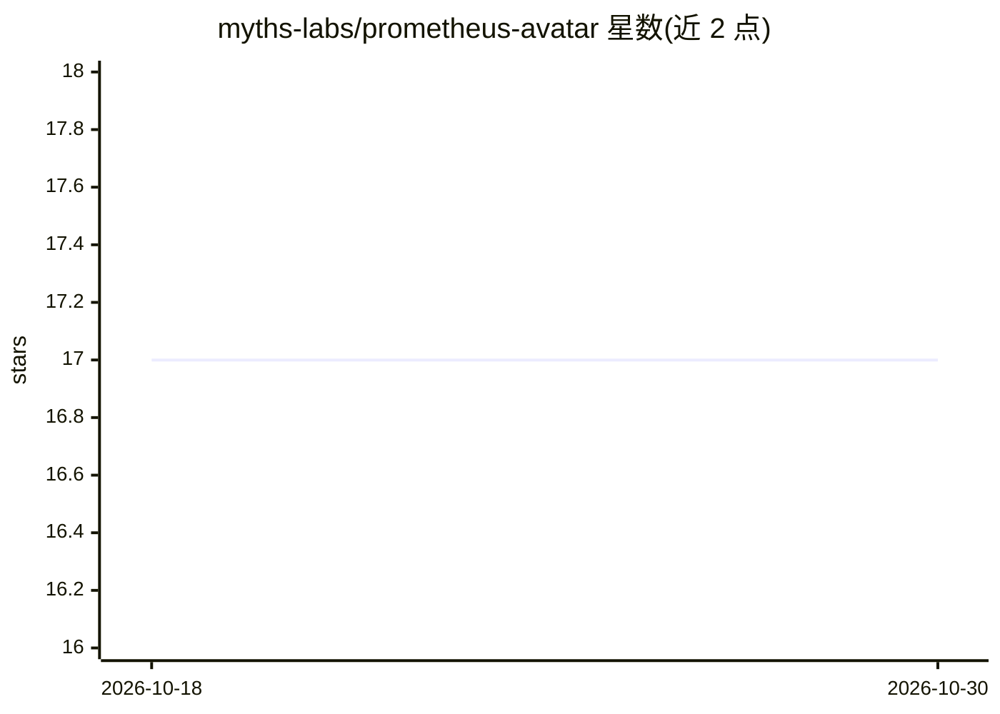

# myths-labs/prometheus-avatar

⭐ 17 · TypeScript · MIT · 推送 2026-10-28 · [GitHub](https://github.com/myths-labs/prometheus-avatar) · [官网](https://prometheus.mythslabs.ai) · 个人维护 · 中文 README

**给 AI 加上虚拟化身：用 LLM 输出驱动 Live2D/3D 形象的 SDK**

开源 TypeScript SDK（@prometheusavatar/core），将任意 LLM 输出转化为 Live2D/3D 化身的实时表现：唇形同步、基于文本的情感引擎触发表情与动作、Gemini Live API 实时语音（约 200ms 延迟）、多语言 TTS 与 VTuber 摄像头面部跟踪。支持 9 家 LLM 提供商及任何 OpenAI 兼容 agent，另提供 MCP 服务器（17 个工具）与 Agent Skill，使 Claude、Cursor 等 AI 客户端可直接获得化身。附带数字资产市场，创作者获得 80-90% 销售分成。面向构建 AI 应用/agent 的开发者，内置 3 个 Live2D 模型，兼容任意 Cubism 2/4 模型文件。

## 筛选速览

| 维度 | 判定 | 备注 |
|---|---|---|
| AI 角色 | `ai-ecosystem` | LLM/agent 周边工具 |
| 许可风险 | `permissive` | MIT |
| 部署形态 | `library` | 以包/库形式分发 |
| 模型依赖 | locked-api |  |
| 硬件要求 | — | 无带数字的原话,不猜 |
| 安装摩擦 | `low` | 无编译、无系统依赖或容器化 |
| 成熟度 | — | 结构信号不足 |

## 能力要点

- LLM 输出驱动 Live2D/3D 化身：唇形同步、情感引擎、实时语音
- 9 家 LLM 提供商可插拔，支持任意 OpenAI 兼容 agent 接入
- MCP 服务器（17 个工具）与 Agent Skill，供 Claude/Cursor 等客户端使用
- Avatar 数字市场：皮肤/语音/特效等资产交易，创作者分成 80-90%

## 适用场景

- 给自己的 AI 应用或 agent 加一个会说话、有表情的虚拟形象
- 让 Claude Desktop、Cursor 等 MCP 客户端一键获得化身
- 构建 VTuber 式实时语音对话应用
- 创作者在市场出售虚拟形象皮肤、语音与特效资产

## 场景标签

`语音 Agent` `语音合成` · 领域:对话与助手

## 证据(README 行号)

> L9:  Open-source SDK for driving Live2D & 3D avatars with any LLM output.
> L42: |🔌 **Multi-LLM**|9 providers: Gemini, OpenAI, Anthropic, Groq, Grok, DeepSeek, Qwen, Kimi, MiniMax|
> L45: |📦 **SDK**|Drop-in `@prometheusavatar/core` for your own apps|

## 星数曲线

2026-10-18 17 → 2026-10-30 17（+0）

---
*卡片 v1 · prompt 1.4 · 生成 2026-10-29 · 置信度 high · 依据 README sha `a2f2410fed0e` · [字段定义](../../DATASET.md)*
