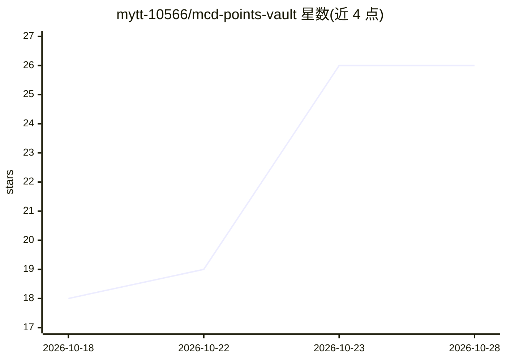

# mytt-10566/mcd-points-vault

⭐ 26 · Python · MIT · 推送 2026-10-09 · [GitHub](https://github.com/mytt-10566/mcd-points-vault) · 个人维护 · 中文 README

**麦当劳积分与优惠券资产体检 Skill：折现值、兑换排行、过期风险**

面向麦当劳会员的积分资产分析技能（SKILL.md 格式，配合 WorkBuddy 与麦当劳 MCP 使用）。核心是一个零依赖、纯 Python 标准库的估值引擎：按『常规价−用券价』计算净节省，折算积分最优汇率、账面价值、30 天风险敞口，输出兑换效率排行与可执行兑换路径。无 Token 可用演示数据离线运行，接入真实账户需在 open.mcd.cn 申请 MCP Token 并配置连接器。写操作需人工确认，不接抽奖。为麦当劳创意大赛参赛作品，非官方产品。

## 筛选速览

| 维度 | 判定 | 备注 |
|---|---|---|
| AI 角色 | `ai-native` | 本体是模型或模型工具 |
| 许可风险 | `permissive` | MIT |
| 部署形态 | `None` |  |
| 模型依赖 | — | README 未给出锁定关系 |
| 硬件要求 | — | 无带数字的原话,不猜 |
| 安装摩擦 | `low` | 无编译、无系统依赖或容器化 |
| 成熟度 | — | 结构信号不足 |

## 能力要点

- 积分/优惠券折算人民币现值与 30 天过期风险敞口
- 每 100 积分兑换效率排行与可执行兑换路径
- 估值引擎零依赖纯标准库，可离线用自有数据运行（--input）
- 通过麦当劳 MCP 拉取真实账户数据，写操作需人工确认

## 适用场景

- 算清楚我的麦当劳积分到底值多少钱、哪项兑换最划算
- 查看哪些积分即将过期并拿到兑换路径
- 把家庭麦当劳权益当资产做一次体检

## 场景标签

`数据分析` · 领域:效率与自动化

## 证据(README 行号)

> L61: 前往 https://open.mcd.cn/mcp ，手机号登录 → 右上角「控制台」→ 点击「激活」→ 一键复制 Token。
> L84: Skill 会自动调用 MCP 拉取你的真实账户数据，然后输出体检报告。
> L121: ├── SKILL.md                      # 技能定义与执行流程

## 星数曲线

2026-10-18 18 → 2026-10-28 26（+8）

---
*卡片 v1 · prompt 1.4 · 生成 2026-10-26 · 置信度 high · 依据 README sha `1b547ceb8aea` · [字段定义](../../DATASET.md)*
