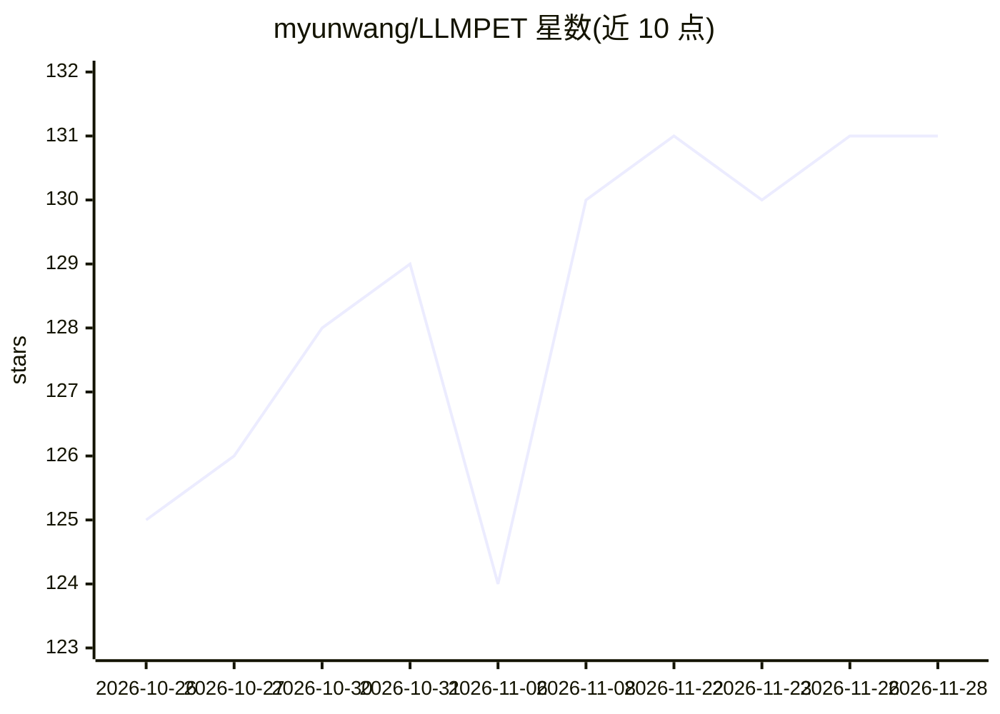

# myunwang/LLMPET

⭐ 131 · JavaScript · MIT · 推送 2026-11-09 · [GitHub](https://github.com/myunwang/LLMPET) · 个人维护 · 中文 README

**盯 Claude Code/Codex/dsh 状态的桌宠工作台，供开发者监看授权与用量**

以桌宠为入口的本地优先多 Agent 工作台，覆盖 Claude Code、OpenAI Codex 与 DeepSeek Harness（dsh）三类编码 agent。桌宠随 agent 状态（思考、干活、等待授权、完成、出错等 21 个状态键）切换表情并弹消息气泡；Claude Code 需授权时可直接在桌宠上点允许/拒绝。通过向 ~/.claude/settings.json 注册 hook 接入 Claude Code，Codex 与 dsh 则只读监听本机会话日志（含 zstd 压缩帧），零配置、不改 agent 配置。还提供统一会话列表、跨 Agent 交接单、token 用量与花费统计。macOS/Windows 可用，从源码以 Node.js 22 + Electron 运行。

## 筛选速览

| 维度 | 判定 | 备注 |
|---|---|---|
| AI 角色 | `ai-ecosystem` | LLM/agent 周边工具 |
| 许可风险 | `permissive` | MIT |
| 部署形态 | `desktop` | 安装包/桌面程序 |
| 模型依赖 | — | README 未给出锁定关系 |
| 硬件要求 | — | 无带数字的原话,不猜 |
| 安装摩擦 | `low` | 无编译、无系统依赖或容器化 |
| 成熟度 | — | 结构信号不足 |

## 能力要点

- 随 agent 状态变表情，Claude Code 授权可在桌宠上直接允许/拒绝
- 接入 Claude Code hook，Codex/dsh 只读监听本机会话日志，零配置卸载无残留
- 统一会话列表与跨 Agent 交接单（本地脱敏、权限 0600）
- token 用量与花费统计，附可追溯的估算口径

## 适用场景

- 跑多个编码 agent 时一眼看出谁在干活、谁在等授权
- 在桌宠上直接处理 Claude Code 的权限请求
- 统一搜索、归档本机三类 agent 的历史会话
- 统计本机 token 用量与花费趋势

## 场景标签

`编码 Agent` · 领域:编码与开发

## 证据(README 行号)

> L17: LLMPET 是一个**以桌宠为入口、本地优先的多 Agent 工作台**，macOS 和 Windows 都能用。Claude Code、OpenAI Codex、DeepSeek Harness 正在干活、在等你授权，还是已经
> L130: LLMPET 的状态机、计量、权限流、进程对账、会话归档和桌面 UI 都在本仓库实现。Claude Code 通过公开 hook 接口接入；Codex 与 DeepSeek Harness 默认只读监听各自的本机会话文件，不修改
> L226: 完整的源码部署、调试、权限与本地打包说明见 《部署到用户本地》。

## 星数曲线

2026-10-26 125 → 2026-11-28 131（+6）

---
*卡片 v1 · prompt 1.4 · 生成 2026-11-28 · 置信度 high · 依据 README sha `9de7c2cc3c1d` · [字段定义](../../DATASET.md)*
