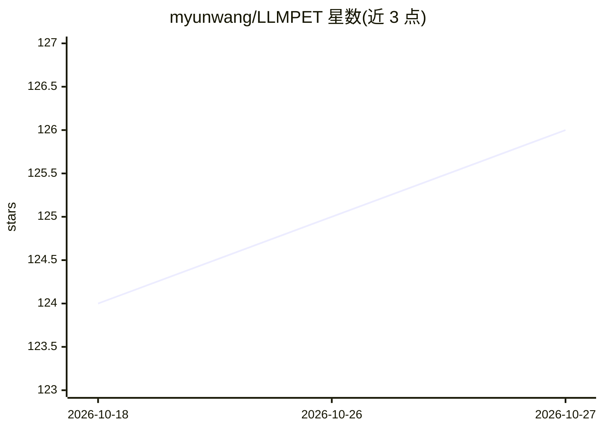

# myunwang/LLMPET

⭐ 126 · JavaScript · MIT · 推送 2026-10-25 · [GitHub](https://github.com/myunwang/LLMPET) · 个人维护 · 中文 README

**监控 Claude Code/Codex/dsh 的桌宠工作台：状态表情、会话管理与交接**

基于 Electron 的本地优先桌面应用：以桌宠形式呈现 Claude Code、OpenAI Codex、DeepSeek Harness（dsh）三类 coding agent 的运行状态（思考/干活/等授权/完成等 21 种状态），支持气泡回复、一键允许/拒绝 Claude 授权、统一会话列表与档案馆、跨 Agent 本地脱敏交接单、token 用量与花费统计。Claude Code 走公开 hook 接口，Codex 与 dsh 只读监听本机会话文件，零配置。支持 macOS/Windows，从源码安装运行。

## 筛选速览

| 维度 | 判定 | 备注 |
|---|---|---|
| AI 角色 | `ai-ecosystem` | LLM/agent 周边工具 |
| 许可风险 | `permissive` | MIT |
| 部署形态 | `library` | 以包/库形式分发 |
| 模型依赖 | locked-api |  |
| 硬件要求 | — | 无带数字的原话,不猜 |
| 安装摩擦 | `low` | 无编译、无系统依赖或容器化 |
| 成熟度 | `idea` | |

## 能力要点

- 桌宠 21 种状态映射三类 agent 的运行事件，支持一键允许/拒绝 Claude 授权
- 跨 Agent 接管：本地提取对话与 Git 摘要、密钥脱敏生成交接单（Claude↔Codex 双向，dsh 单向作来源）
- Codex/dsh 后端零配置只读监听本机会话日志，dsh 支持 zstd 分帧解析且未知版本 fail-closed
- 统一会话档案馆、增量备份与按 message.id 去重的 token 计量、花费估算

## 适用场景

- 同时用多个 coding agent 时在桌面统一看状态、找会话、回到原窗口
- 把一项工作从一个 agent 安全交接给另一个 agent 继续
- 在桌宠上直接处理 Claude Code 的授权请求
- 统计本机各 agent 的 token 用量与花费趋势

## 场景标签

`LLM 可观测性` · 领域:评测与运维

## 证据(README 行号)

> L8: LLMPET 是一个**以桌宠为入口、本地优先的多 Agent 工作台**。它把 **Claude Code、OpenAI Codex 和 DeepSeek Harness** 的会话放到同一个桌面层：看状态、找会话、回到原窗口、管
> L77: LLMPET 的状态机、计量、权限流、进程对账、会话归档和桌面 UI 都在本仓库实现。Claude Code 通过公开 hook 接口接入；Codex 与 DeepSeek Harness 默认只读监听各自的本机会话文件，不修改 

## 星数曲线

2026-10-18 124 → 2026-10-27 126（+2）

---
*卡片 v1 · prompt 1.4 · 生成 2026-10-23 · 置信度 mid · 依据 README sha `e8589dc3e00d` · [字段定义](../../DATASET.md)*
