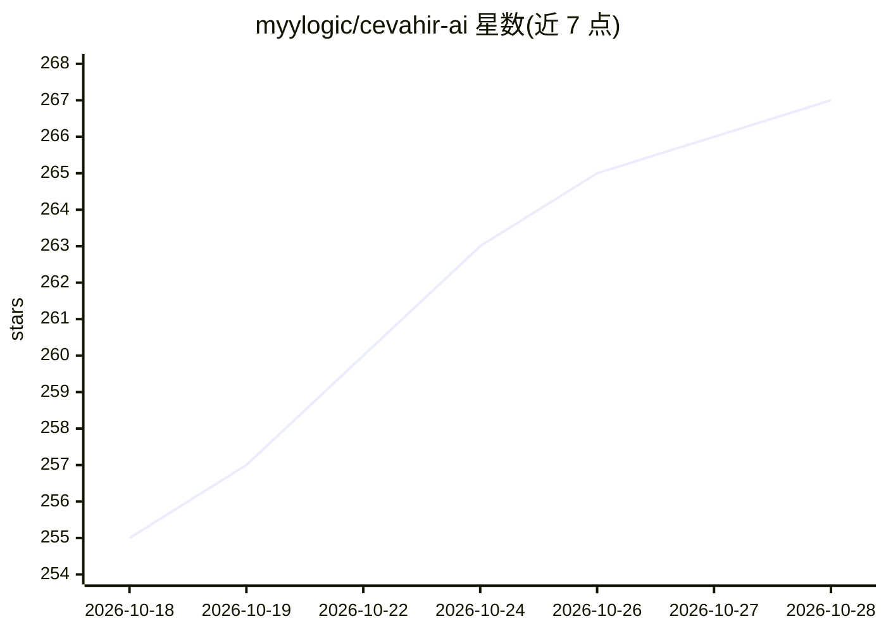

# myylogic/cevahir-ai

⭐ 267 · Python · Apache-2.0 · 推送 2026-10-13 · [GitHub](https://github.com/myylogic/cevahir-ai) · 个人维护

**面向土耳其语的 LLM 训练与认知对话引擎，供开发者自训模型**

单一作者维护的开源 AI 引擎，将面向土耳其语的 BPE 分词器、可配置 PyTorch Transformer 解码器（支持 MHA/MQA/GQA、RoPE/YaRN、MoE、KV 缓存等）、训练与检查点管理、生成、认知工作流（direct/think/debate/Tree of Thoughts）、会话记忆与应用服务整合在同一代码库。定位为研究与教育项目，不再以产品化为目标。用户可用自有数据训练模型并通过统一接口接入对话应用。

## 筛选速览

| 维度 | 判定 | 备注 |
|---|---|---|
| AI 角色 | `ai-ecosystem` | LLM/agent 周边工具 |
| 许可风险 | `permissive` | Apache-2.0 |
| 部署形态 | `library` | 以包/库形式分发 |
| 模型依赖 | — | README 未给出锁定关系 |
| 硬件要求 | — | 无带数字的原话,不猜 |
| 安装摩擦 | `low` | 无编译、无系统依赖或容器化 |
| 成熟度 | — | 结构信号不足 |

## 能力要点

- 土耳其语专用 BPE 分词器（音节划分与词形组件可配置）
- 可配置 Transformer 解码器：GQA/MQA、MoE、KV 缓存、梯度检查点
- 训练系统含断点续训、检查点轮换与缓存完整性校验
- 认知层提供 direct/think/debate/Tree of Thoughts 工作流与工具调用

## 适用场景

- 在自己的数据上训练土耳其语语言模型
- 检查并修改从分词到生成的完整模型路径
- 通过认知工作流与会话管理构建对话应用
- 作为语言模型引擎的教学与研究基础

## 场景标签

`模型训练` `Agent 框架` `教程课程` · 领域:Agent 开发

## 证据(README 行号)

> L7: **An AI engine combining tokenizer infrastructure developed specifically for Turkish, a trainable language-model cor
> L9: I'm Muhammed Yasin Yılmaz. I built Cevahir to bring data preparation, model learning and the use of a trained model 
> L29: With Cevahir, I want to bring **language representation, model learning and model use into one extensible system.**

## 星数曲线

2026-10-18 255 → 2026-10-28 267（+12）

---
*卡片 v1 · prompt 1.4 · 生成 2026-10-22 · 置信度 high · 依据 README sha `66c54b6f7219` · [字段定义](../../DATASET.md)*
