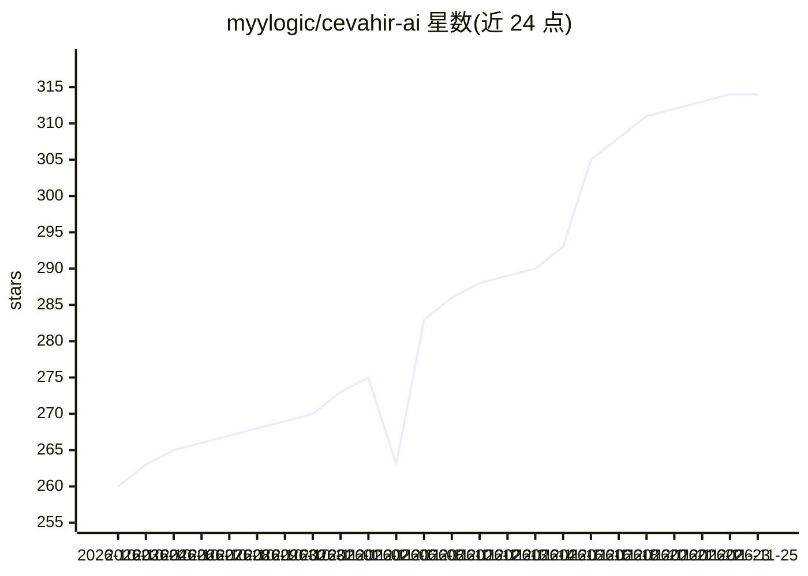

# myylogic/cevahir-ai

⭐ 314 · Python · Apache-2.0 · 推送 2026-11-23 · [GitHub](https://github.com/myylogic/cevahir-ai) · 个人维护

**从对话中持续学习的心智模型引擎，附土耳其语 BPE 与 Transformer 核心**

仓库包含两条线：新核心 Cevahir Zihin 不用权重矩阵与反向传播，把知识存为带来源（亲见/告知/推断/想象等）的证据纽带，以七席位焦点取代上下文窗口，每次对话即学习，支持精确撤回单条经历、自主检索网络（含 robots.txt 限速网关）与批量问答。另含土耳其语 BPE 分词器、PyTorch Transformer 解码器与训练检查点管理。需 Python 3.11+，克隆后本地运行；现有心智模型由作者私有的土耳其语数据养成，未随仓库分发。

## 筛选速览

| 维度 | 判定 | 备注 |
|---|---|---|
| AI 角色 | `ai-native` | 本体是模型或模型工具 |
| 许可风险 | `permissive` | Apache-2.0 |
| 部署形态 | `library` | 以包/库形式分发 |
| 模型依赖 | — | README 未给出锁定关系 |
| 硬件要求 | — | 无带数字的原话,不猜 |
| 安装摩擦 | `low` | 无编译、无系统依赖或容器化 |
| 成熟度 | `idea` | |

## 能力要点

- 证据带来源标记，可对单条经历精确撤回
- 无上下文窗口设计，时刻耗时随规模缓慢增长
- 自主决定何时检索，内置礼貌爬取网关与离线缓存
- 附 BPE 分词器、Transformer 解码器与训练/检查点管理

## 适用场景

- 通过对话和文档让模型从零学习一门语言
- 研究非 Transformer 的认知架构与持续学习机制
- 在本地以土耳其语文本训练自定义语言模型

## 场景标签

`RAG` · 领域:知识与检索

## 证据(README 行号)

> L11: > The new model in this repository, Cevahir Zihin (`zihin/`, what `python -m zihin` runs), is not a neural network
> L68: > **There is no separate training phase; the model learns in every conversation. Please speak to it kindly.**
> L120: **An open-source AI research engine: a new mind core that learns by living (Cevahir Zihin), alongside Turkish-spec

## 星数曲线

2026-10-23 260 → 2026-11-25 314（+54）

---
*卡片 v1 · prompt 1.4 · 生成 2026-11-25 · 置信度 mid · 依据 README sha `ac2f95f0acf0` · [字段定义](../../DATASET.md)*
