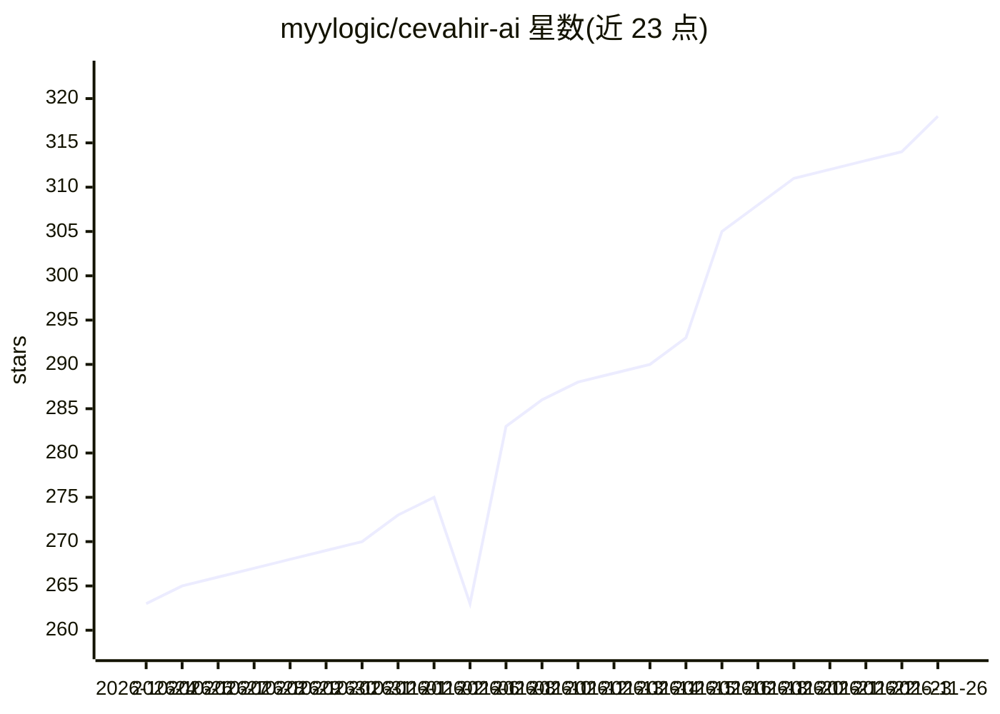

# myylogic/cevahir-ai

⭐ 318 · Python · Apache-2.0 · 推送 2026-11-25 · [GitHub](https://github.com/myylogic/cevahir-ai) · 个人维护

**对话中持续学习的非 Transformer 认知语言模型引擎**

Cevahir AI 仓库包含一个名为 Cevahir Zihin 的语言模型，作者声明其非神经网络：以 tie（关系）存储带来源标注的证据，用 Seven-Place Focus 机制读取（无上下文窗口），无独立训练阶段、在每次对话中学习，支持精确撤销记忆、一次阅读后的序列回忆、自主决定联网查询（经 robots.txt 合规网关读取网页）。仓库另含土耳其语 BPE 分词器与早期的 Transformer 引擎。需 Python 3.11+，从源码克隆运行，交互界面为土耳其语。

## 筛选速览

| 维度 | 判定 | 备注 |
|---|---|---|
| AI 角色 | `ai-native` | 本体是模型或模型工具 |
| 许可风险 | `permissive` | Apache-2.0 |
| 部署形态 | `library` | 以包/库形式分发 |
| 模型依赖 | — | README 未给出锁定关系 |
| 硬件要求 | — | 无带数字的原话,不猜 |
| 安装摩擦 | `low` | 无编译、无系统依赖或容器化 |
| 成熟度 | `idea` | |

## 能力要点

- 以证据 tie 与七位焦点机制实现无上下文窗口的读取
- 无独立训练阶段，在对话中学习，支持精确撤销记忆（Exact Retraction）
- 自主决定联网查询，网页读取经限制频率、遵守 robots.txt 的网关
- 仓库另含土耳其语 BPE 分词器与早期 Transformer 引擎

## 适用场景

- 与模型对话并直接教授它文档与问答对（.txt/.md/.docx/.pdf/.tsv）
- 研究非 Transformer 架构的语言学习机制
- 在本地单核/少量核心上运行一个自建认知语言模型

## 场景标签

`聊天机器人` · 领域:对话与助手

## 证据(README 行号)

> L11: > The new model in this repository, Cevahir Zihin (`zihin/`, what `python -m zihin` runs), is not a neural network
> L110: > **There is no separate training phase; the model learns in every conversation. Please speak to it kindly.**
> L125: python -m zihin

## 星数曲线

2026-10-24 263 → 2026-11-26 318（+55）

---
*卡片 v1 · prompt 1.4 · 生成 2026-11-26 · 置信度 low · 依据 README sha `6aaf487cb5c2` · [字段定义](../../DATASET.md)*
