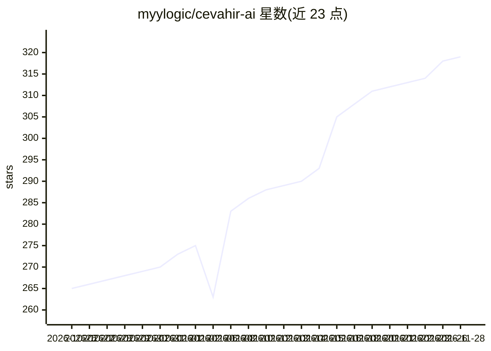

# myylogic/cevahir-ai

⭐ 319 · Python · Apache-2.0 · 推送 2026-11-26 · [GitHub](https://github.com/myylogic/cevahir-ai) · 个人维护

**通过对话持续学习的证据记忆模型及土耳其语 NLP 引擎**

仓库包含两条路径：新的 Cevahir Zihin（zihin/，python -m zihin 运行）不使用权重矩阵、反向传播或 softmax 注意力，而是把知识保存为带来源证据的 tie，以 Seven-Place Focus 机制在每次对话中学习，支持精确撤回、主动查网（遵守 robots.txt）、批量问答与睡眠遗忘；此前的 Transformer 语言模型核心与土耳其语 BPE 分词器仍保留在仓库中。需要 Python 3.11+，从源码克隆运行，torch/numpy 及 python-docx/pypdf/pillow 为可选依赖，程序界面为土耳其语。

## 筛选速览

| 维度 | 判定 | 备注 |
|---|---|---|
| AI 角色 | `ai-native` | 本体是模型或模型工具 |
| 许可风险 | `permissive` | Apache-2.0 |
| 部署形态 | `library` | 以包/库形式分发 |
| 模型依赖 | — | README 未给出锁定关系 |
| 硬件要求 | — | 无带数字的原话,不猜 |
| 安装摩擦 | `low` | 无编译、无系统依赖或容器化 |
| 成熟度 | `idea` | |

## 能力要点

- 知识以 tie 上的证据保存，可在会话内精确撤回输入（!unut）
- Seven-Place Focus 机制，无上下文窗口，每次对话中学习
- 自主决定联网查询未知条目，网页读取遵守 robots.txt（zihin/ag.py）
- 附带土耳其语 BPE 分词器与早期 Transformer 语言模型核心

## 适用场景

- 以对话方式从零教一个模型学习语言与知识
- 读取本地 .txt/.md/.docx/.pdf 文档并向其提问
- 研究非 Transformer 架构的语言学习机制

## 场景标签

`RAG` `文档问答` `聊天机器人` · 领域:对话与助手

## 证据(README 行号)

> L9: > **Latest update — November 2026: Cevahir Zihin, a mind that learns by living. Not a Transformer.**
> L112: > **There is no separate training phase; the model learns in every conversation. Please speak to it kindly.**
> L127: python -m zihin

## 星数曲线

2026-10-26 265 → 2026-11-28 319（+54）

---
*卡片 v1 · prompt 1.4 · 生成 2026-11-27 · 置信度 mid · 依据 README sha `4d43adf705ac` · [字段定义](../../DATASET.md)*
