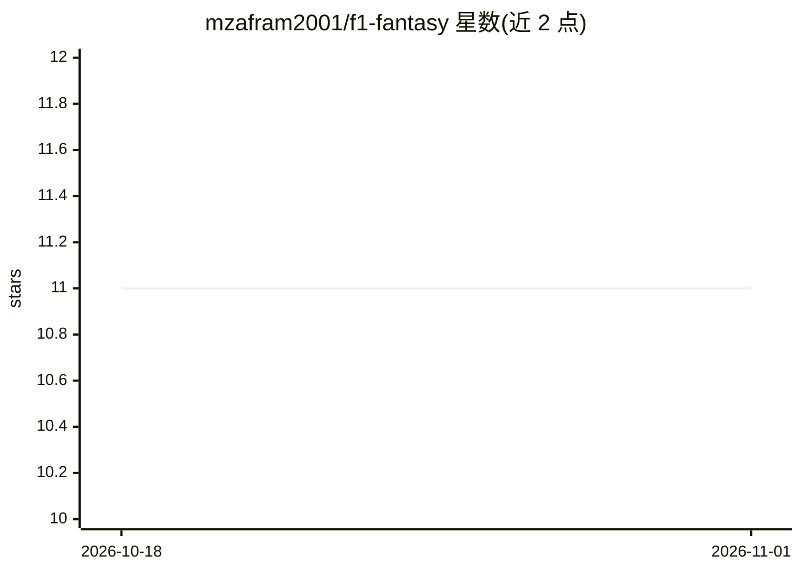

# mzafram2001/f1-fantasy

⭐ 11 · Python · MIT · 推送 2026-10-31 · [GitHub](https://github.com/mzafram2001/f1-fantasy) · 个人维护

**自动化更新的 F1 Fantasy 历史数据集（JSON 格式）**

由 GitHub Actions 在每个大奖赛周末后自动抓取、清洗并结构化官方 F1 Fantasy 数据的仓库。数据按赛季与轮次存为 JSON 文件，schema 分为 Meta、Drivers、Teams 三部分，包含积分明细、身价、选择率、排位/冲刺/正赛积分等字段，可经 pandas 直接从 GitHub 读取。面向做分析、机器学习与数据可视化的用户，覆盖 2023 至 2026 赛季数据；README 声明仅供教育与研究用途。

## 筛选速览

| 维度 | 判定 | 备注 |
|---|---|---|
| AI 角色 | `ai-knowledge` | 知识聚合/清单类 |
| 许可风险 | `permissive` | MIT |
| 部署形态 | `None` |  |
| 模型依赖 | — | README 未给出锁定关系 |
| 硬件要求 | — | 无带数字的原话,不猜 |
| 安装摩擦 | `low` | 无编译、无系统依赖或容器化 |
| 成熟度 | — | 结构信号不足 |

## 能力要点

- 每个大奖赛周末后自动抓取、清洗并结构化官方 F1 Fantasy 数据
- 标准化 JSON schema（Meta/Drivers/Teams），含积分、身价、选择率等字段
- 提供 pandas 直接从 GitHub 读取的快速开始示例
- 覆盖 2023-2026 多个赛季的轮次数据

## 适用场景

- 分析 F1 Fantasy 车手与车队的积分、身价与选择率趋势
- 为机器学习或数据可视化项目提供 F1 Fantasy 历史数据源
- 研究不同赛季的 Fantasy 阵容价值变化

## 场景标签

 · 领域:体育数据/开放数据集

## 证据(README 行号)

> L9: An open-source, automated historical dataset of F1 Fantasy statistics.
> L11: This repository automatically fetches, cleans, and structures official F1 Fantasy data after every Grand Prix weeke

## 星数曲线

2026-10-18 11 → 2026-11-01 11（+0）

---
*卡片 v1 · prompt 1.4 · 生成 2026-11-01 · 置信度 high · 依据 README sha `dce5132937f4` · [字段定义](../../DATASET.md)*
