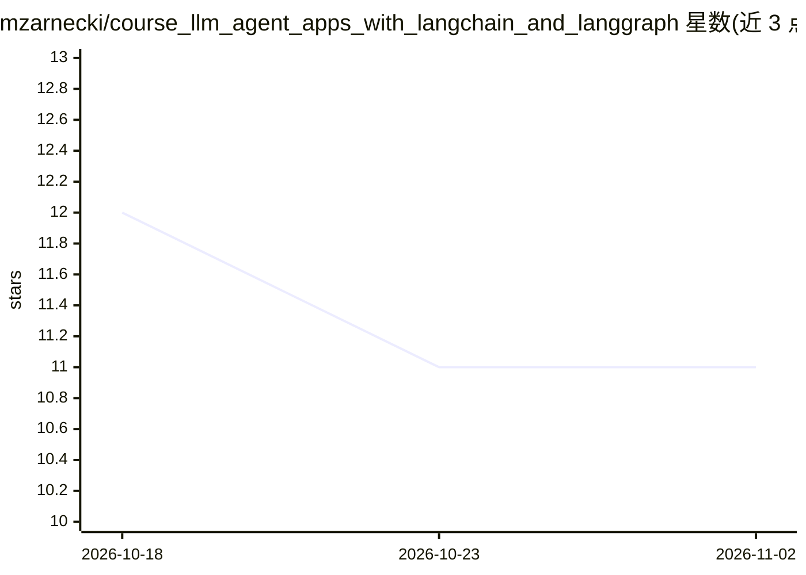

# mzarnecki/course_llm_agent_apps_with_langchain_and_langgraph

⭐ 11 · Jupyter Notebook · NOASSERTION · 推送 2026-10-22 · [GitHub](https://github.com/mzarnecki/course_llm_agent_apps_with_langchain_and_langgraph) · 个人维护

**LangChain/LangGraph LLM 应用与 Agent 开发教程笔记本集**

配套 videopoint/Helion 2025/2026 视频课程的 Jupyter 笔记本仓库：用 LangChain 与 LangGraph（Python）演示从基础组件（提示、模型参数、记忆、链）到 ReAct/多 Agent、RAG、评估指标（BLEU/ROUGE/Criteria/Trajectory）、Guardrails 及 Streamlit RAG 聊天应用的渐进式示例，含代码输出与解释，另附 Medium 文章链接与波兰语练习目录。运行方式为 Google Colab（浏览器内、零安装、示例中配置 OPENAI_API_KEY）或本地 uv sync；代码保持与两库当前语法同步，旧 API 走 langchain-classic 兼容层。

## 筛选速览

| 维度 | 判定 | 备注 |
|---|---|---|
| AI 角色 | `ai-knowledge` | 知识聚合/清单类 |
| 许可风险 | `none` | NOASSERTION |
| 部署形态 | `None` |  |
| 模型依赖 | — | README 未给出锁定关系 |
| 硬件要求 | — | 无带数字的原话,不猜 |
| 安装摩擦 | `low` | 无编译、无系统依赖或容器化 |
| 成熟度 | — | 结构信号不足 |

## 能力要点

- 约 28 个笔记本覆盖基础→链/工具/Agent→LangGraph→多 Agent 应用
- 含评估（文本指标/Criteria/Trajectory）与 Guardrails 专篇
- 支持 Google Colab 一键打开与本地 uv 锁定依赖两种运行方式
- 双语（英/波）说明并附 Medium 文章系列

## 适用场景

- 系统学习 LangChain 与 LangGraph 构建 LLM 应用和 Agent
- 参考 RAG、多 Agent、评估与 Guardrails 的可运行示例
- 课程学员结合视频与练习目录自学

## 场景标签

`教程课程` · 领域:学习与行业

## 证据(README 行号)

> L7: This repository contains Jupyter notebooks with examples for building LLM-based applications and AI agents with Lang
> L9: The examples provided in the notebooks are practical, guiding you through increasingly advanced applications of LLMs
> L88: Repozytorium zawiera notatniki Jupyter z przykładami do kursu "Tworzenie aplikacji opartych na LLM i agentach AI z 

## 星数曲线

2026-10-18 12 → 2026-11-02 11（-1）

---
*卡片 v1 · prompt 1.4 · 生成 2026-11-01 · 置信度 high · 依据 README sha `4f5bf56e34b0` · [字段定义](../../DATASET.md)*
