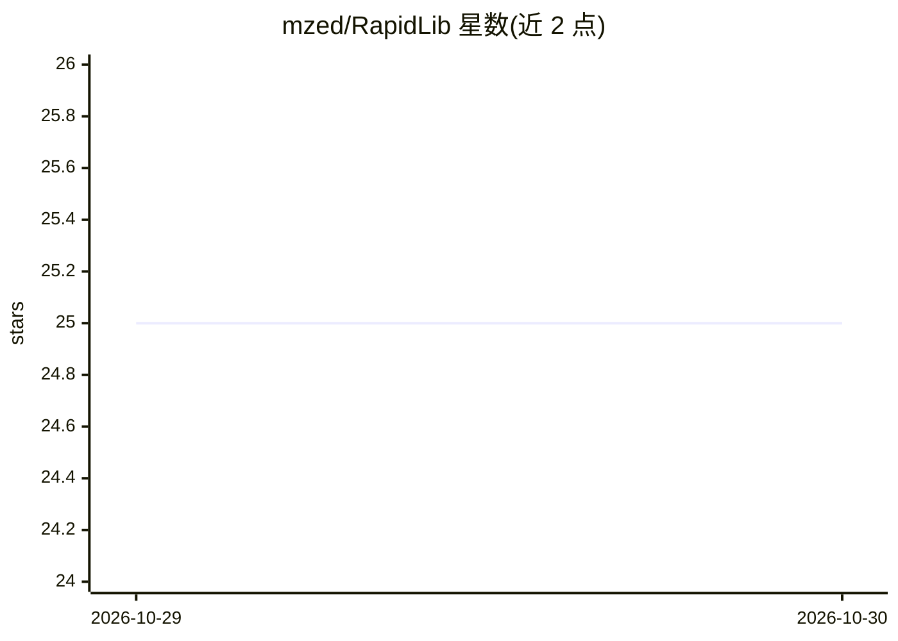

# mzed/RapidLib

⭐ 25 · C++ · BSD-3-Clause · 推送 2026-10-29 · [GitHub](https://github.com/mzed/RapidLib) · [官网](https://mzed.github.io/RapidLib/) · 个人维护

**轻量级交互式机器学习库：分类/回归/序列分类**

RapidLib 是一个面向交互式机器学习的轻量级库，当前提供三种模型：基于 kNN 的分类、基于多层感知机的回归、基于动态时间规整（DTW）的序列分类。README 展示了 main 与 dev 两个分支在 Linux、Windows、macOS 上的持续构建状态，更多文档见项目主页。README 未给出安装命令与语言绑定细节，具体用法需查阅外部文档。

## 筛选速览

| 维度 | 判定 | 备注 |
|---|---|---|
| AI 角色 | `ai-native` | 本体是模型或模型工具 |
| 许可风险 | `permissive` | BSD-3-Clause |
| 部署形态 | `None` |  |
| 模型依赖 | — | README 未给出锁定关系 |
| 硬件要求 | — | 无带数字的原话,不猜 |
| 安装摩擦 | `low` | 无编译、无系统依赖或容器化 |
| 成熟度 | — | 结构信号不足 |

## 能力要点

- kNN 分类
- 多层感知机回归
- 动态时间规整（DTW）序列分类
- Linux/Windows/macOS 持续构建（main 与 dev 分支）

## 适用场景

- 在交互式应用中快速训练分类或回归模型
- 对时间序列数据做序列分类
- 嵌入式或轻量场景下的交互式机器学习实验

## 场景标签

 · 领域:机器学习

## 证据(README 行号)

> L15: RapidLib is a lightweight library for interactive machine learning. It currently features classification (using kNN

## 星数曲线

2026-10-29 25 → 2026-10-30 25（+0）

---
*卡片 v1 · prompt 1.4 · 生成 2026-10-28 · 置信度 mid · 依据 README sha `d9692213beef` · [字段定义](../../DATASET.md)*
