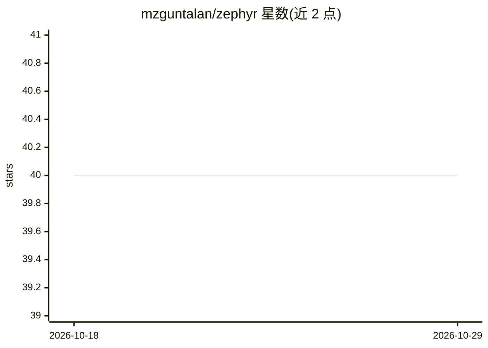

# mzguntalan/zephyr

⭐ 40 · Python · Apache-2.0 · 推送 2026-03-21 · [GitHub](https://github.com/mzguntalan/zephyr) · 个人维护

**JAX 之上的声明式神经网络构建库**

基于 JAX 的轻量神经网络库：把网络定义为纯函数 f(params, x)，由 trace 函数完成参数初始化，消除参数创建与处理的样板代码；无子类化、无 __call__、无隐藏状态，状态（params）与结构完全分离。设计受 Haiku 的 transform 机制启发，并参考 TensorFlow、PyTorch、Flax、Equinox 等框架的特性。以 pip 包形式提供，当前版本 0.0.22。

## 筛选速览

| 维度 | 判定 | 备注 |
|---|---|---|
| AI 角色 | `ai-ecosystem` | LLM/agent 周边工具 |
| 许可风险 | `permissive` | Apache-2.0 |
| 部署形态 | `library` | 以包/库形式分发 |
| 模型依赖 | — | README 未给出锁定关系 |
| 硬件要求 | — | 无带数字的原话,不猜 |
| 安装摩擦 | `low` | 无编译、无系统依赖或容器化 |
| 成熟度 | — | 结构信号不足 |

## 能力要点

- 网络即纯函数 f(params, x)，无子类化与隐藏状态
- trace 函数自动初始化 params
- 状态（params）与结构完全分离
- 基于 JAX，接近原生函数式风格

## 适用场景

- 用纯函数风格在 JAX 中定义神经网络
- 减少 JAX 下参数创建与管理的样板代码
- 需要参数 PyTree 与模型结构分离的工作流

## 场景标签

 · 领域:机器学习框架

## 证据(README 行号)

> L5: **Zephyr** makes writing functional code in JAX for neural networks and machine learning a breeze. No subclassing, n
> L7: - Minimal library, minimal learning curve; zephyr solves the frustration working in pure JAX :: parameter creation a
> L40: This library is heavily inspired by Haiku's `transform` function which eventually

## 星数曲线

2026-10-18 40 → 2026-10-29 40（+0）

---
*卡片 v1 · prompt 1.4 · 生成 2026-10-25 · 置信度 high · 依据 README sha `4550dab57c45` · [字段定义](../../DATASET.md)*
