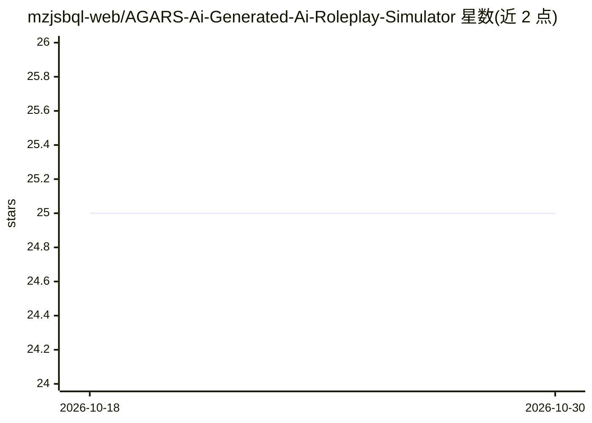

# mzjsbql-web/AGARS-Ai-Generated-Ai-Roleplay-Simulator

⭐ 25 · Python · AGPL-3.0 · 推送 2026-04-11 · [GitHub](https://github.com/mzjsbql-web/AGARS-Ai-Generated-Ai-Roleplay-Simulator) · 个人维护 · 中文 README

**多智能体分离式 AI 角色扮演模拟器：知识图谱记忆+剧本规划**

基于 MiroFish 二次开发的互动叙事引擎，Web 前后端架构（Vue + Flask）。将叙事、角色扮演、世界管理拆分为独立 agent 各自调用，避免单轮对话堆叠多任务；用 FalkorDB / Zep 知识图谱存储角色关系与世界事实，按需检索替代长上下文堆叠，并按职责分配不同模型与上下文窗口。世界状态在引擎层维护（地图拓扑、角色位置、物品归属），移动经邻接图验证；内置 monitor 查看每次调用的完整 prompt。需自备 OpenAI SDK 兼容的 LLM API、Zep Cloud 与 Embedding API 密钥，可选 Docker Compose 部署。

## 筛选速览

| 维度 | 判定 | 备注 |
|---|---|---|
| AI 角色 | `ai-native` | 本体是模型或模型工具 |
| 许可风险 | `viral` | AGPL-3.0 |
| 部署形态 | `self-host` | docker 或自建部署 |
| 模型依赖 | — | README 未给出锁定关系 |
| 硬件要求 | — | 无带数字的原话,不猜 |
| 安装摩擦 | `low` | 无编译、无系统依赖或容器化 |
| 成熟度 | — | 结构信号不足 |

## 能力要点

- 叙事/角色扮演/世界管理分离为独立 agent 执行
- 基于 FalkorDB / Zep 的知识图谱结构化记忆与按需检索
- 世界状态在引擎层维护，移动经邻接图验证
- monitor 实时查看每次调用的完整 prompt

## 适用场景

- 运行多角色互动叙事与 AI 角色扮演模拟
- 追踪角色关系与世界事实并按需检索记忆
- 通过 prompt 编辑与 monitor 调试和定制叙事行为

## 场景标签

`多智能体` `Agent 记忆` · 领域:Agent 开发

## 证据(README 行号)

> L7: **AGARS** 是基于 MiroFish 的二次开发项目，专注于 AI 驱动的角色扮演模拟。
> L9: 常规 AI 角色扮演前端在单轮对话中同时处理叙事、角色扮演与世界管理，AI 推理能力被严重稀释；再靠堆叠上下文长度弥补记忆，成本高且信息易丢失。本项目将上述任务分离至独立 agent 分别执行，每次调用只做一件事，显著提升推理质量；
> L19: - **任务分离架构**：叙事、角色扮演、世界管理由独立 agent 分别执行，不在单轮对话中堆叠多任务——AI 每次只做一件事，推理质量显著提升

## 星数曲线

2026-10-18 25 → 2026-10-30 25（+0）

---
*卡片 v1 · prompt 1.4 · 生成 2026-10-27 · 置信度 high · 依据 README sha `e7680f6c42c2` · [字段定义](../../DATASET.md)*
